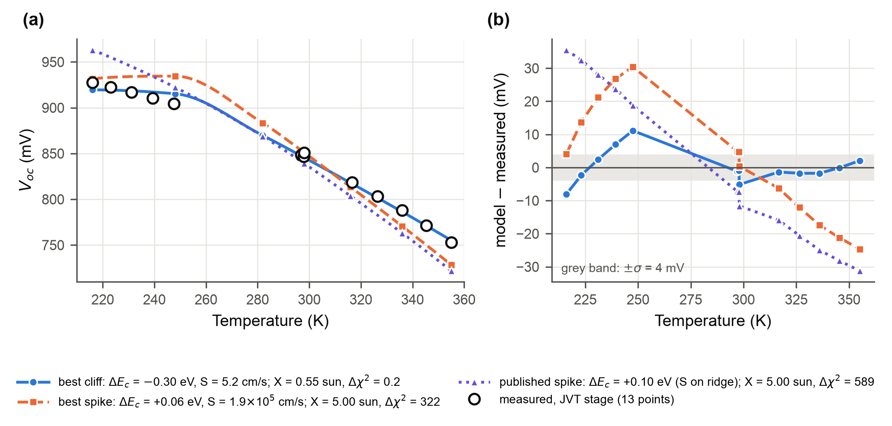
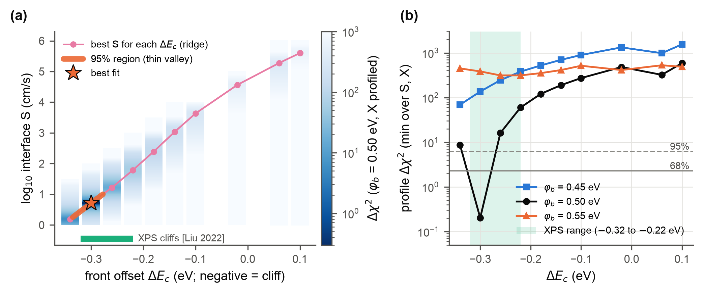
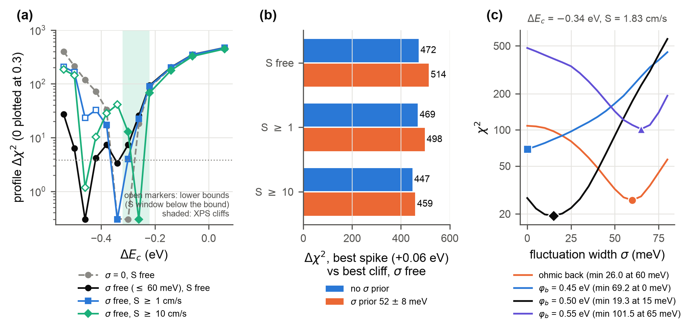
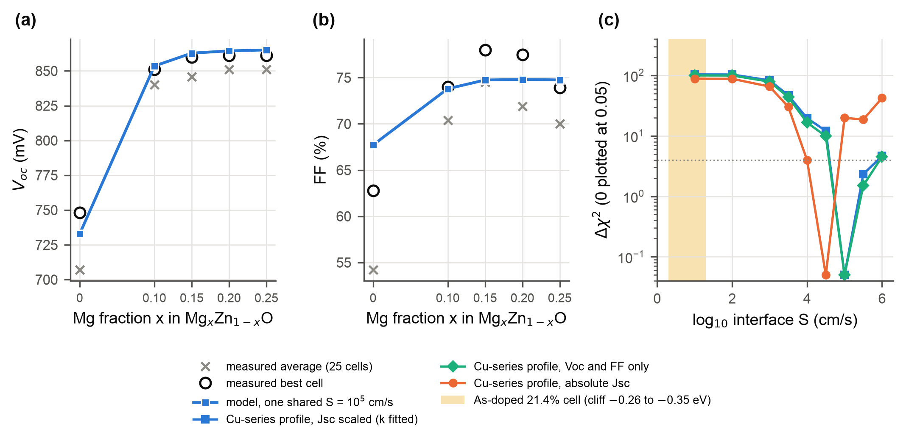
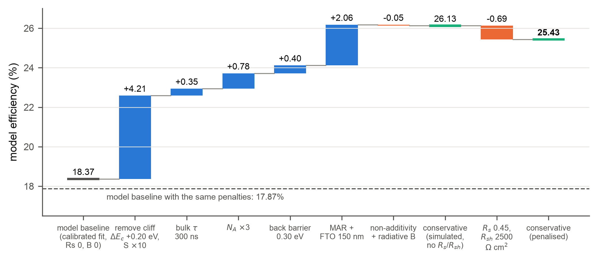
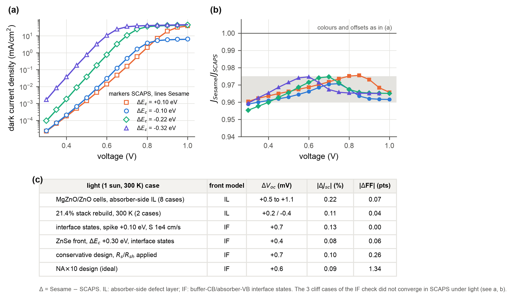
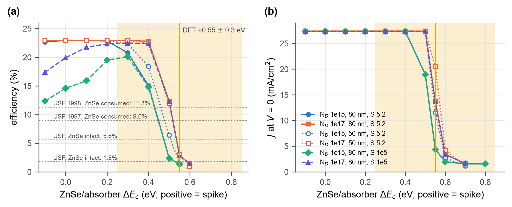

<p align="center"><a href="https://soham-cheme.github.io/CdTe-Solar-Cell-Device-Model/"></a></p>

<p align="center"><b><a href="https://soham-cheme.github.io/CdTe-Solar-Cell-Device-Model/">Open the live page</a></b> · scroll the front band offset from the published spike to the best-fit cliff and read the fit at every simulated step, then every result figure of the study</p>

<div align="center">

[](https://scaps.elis.ugent.be/)
[](https://github.com/usnistgov/sesame)
[](https://www.quantum-espresso.org/)
[](docs/figures/F6_solver_crossvalidation.png)
[](scripts/make_figures.py)
[](docs/CLAIMS.md)
[](#citation)

**Soham Kavathekar** · MS Chemical & Biomolecular Engineering, University of Pennsylvania
[stg3719@seas.upenn.edu](mailto:stg3719@seas.upenn.edu) · [linkedin.com/in/soham-kavathekar-cheme](https://www.linkedin.com/in/soham-kavathekar-cheme)

</div>

# CdTe solar cells: a passivated cliff, not a spike

**Calibrated, cross-validated device modelling of a 21.4 % ZnO/CdSeTe/CdTe solar cell, and an uncertainty-banded design route beyond it.**

Front-buffer design for CdTe-family cells rests on one rule: a small conduction-band spike at the buffer/absorber
interface helps, and a cliff hurts. The 21.4 % As-doped CdSeTe/CdTe cell of Kujović et al. (*Adv. Funct. Mater.* 2024),
built on a First Solar absorber with a highly resistive intrinsic ZnO buffer, is a direct test of that rule. This
repository fits its published J-V, quantum efficiency and temperature-dependent open-circuit voltage with two
independent drift-diffusion solvers, SCAPS-1D and NIST Sesame, maps what the data can and cannot identify, tests
whether band-gap fluctuations can imitate the answer, adds first-principles band offsets, and only then designs.

> **Result.** Our reanalysis indicates that the 21.4 % cell runs on a **passivated conduction-band cliff** at the ZnO
> front. The +0.10 eV spike assumed in the published device model is excluded (Δχ² ≥ 447 under every bound on S and
> every fluctuation prior tested). A cliff of at least about −0.26 eV is required; the best fit is
> **ΔE<sub>c</sub> = −0.30 eV with an effective interface recombination velocity S ≈ 5 cm/s**. Removing the cliff
> while keeping that interface clean is the dominant design lever: a conservative design reaches **25.4 % in both
> solvers**, +7.6 points over the calibrated baseline under identical penalties (17.87 → 25.43 %). That penalised
> baseline sits 3.6 points below the measured 21.44 %; the EQE-anchored projection for the real cell, 19.5 → 27.8 %,
> is a projection, not a simulation.

## Key results

- **The spike is excluded.** Fitted jointly to the 13-point V<sub>oc</sub>(T) curve (216–355 K) and the 1-sun J-V,
  the published +0.10 eV spike sits at Δχ² ≈ 590. With band-gap fluctuations refitted, even the best spike stays at
  Δχ² = 447–514 for every bound on S, with and without a photoluminescence prior on their width. Neither a different back barrier (0.45–0.55 eV) nor any S from
  1 to 4 × 10⁵ cm/s rescues it ([F1](docs/figures/F1_vocT_cliff_vs_spike.png)).
- **A passivated cliff fits.** Best fit ΔE<sub>c</sub> = −0.30 eV, S ≈ 5 cm/s, back barrier 0.50 eV (the barrier
  itself is not a robust inference, see below), χ² = 21.7 for 12 degrees of freedom; 95 % region on ΔE<sub>c</sub>
  −0.335 to −0.277 eV (identifiability pipeline, Δχ² = 6.2; 68 % region at Δχ² = 2.3). The independent XPS
  value for close-space-sublimated CdSeTe measured by the same research group, −0.32 eV (Liu et al., PVSC 2022), lies inside the 68 %
  region. A cliff of at least about −0.26 eV is required in every fluctuation and S-bound case.
- **Identifiability mapped, not assumed.** Room-temperature J-V leaves ΔE<sub>c</sub> and S on a ridge (12.9 decades
  of S per eV of cliff depth); temperature closes it. S, ΔE<sub>c</sub> and the fluctuation width trade along one valley
  that a physical bound on S closes, and the low-temperature V<sub>oc</sub> flattening is carried by either a ~0.5 eV
  back barrier or ~60 meV fluctuations, so the back barrier is not a robust inference
  ([F2](docs/figures/F2_identifiability.png), [F3](docs/figures/F3_fluctuation_gate.png)).
- **The ZnO paradox is interface quality.** The same nominal buffer gives 21.4 % on an As-doped absorber and an
  average of 8.0 % on Cu-doped ones (Pandey et al., *Solar RRL* 2021). One shared S ≈ 10⁵ cm/s reproduces the best-cell
  V<sub>oc</sub> of the entire Cu-doped Mg<sub>x</sub>Zn<sub>1−x</sub>O series (1,980 J-V simulations, none failed);
  S<sub>Cu</sub>/S<sub>As</sub> ≥ 100 at each cell's own cliff; at equal cliff the ratio depends on how the As cell's S
  is mapped (about 3–200× k-scaled, 2–9× with absolute J<sub>sc</sub>). Higher absorber doping does not rescue a ZnO
  front ([F4](docs/figures/F4_pandey_oneS.png)).
- **Design route: 25.4 % in SCAPS and Sesame.** Removing the cliff (ΔE<sub>c</sub> 0 to +0.20 eV) gains 4.2–4.3
  points while S stays below about 50 cm/s; no spike is needed. A conservative design (ΔE<sub>c</sub> +0.20 eV with
  S ×10, 300 ns lifetime, N<sub>A</sub> ×3, 0.30 eV back barrier, idealised front optics, 150 nm FTO), penalised with
  radiative recombination and R<sub>s</sub>/R<sub>sh</sub> = 0.45/2500 Ω cm², gives 25.43 % (1015.0 mV) in Sesame and
  25.36 % (1014.3 mV) in SCAPS: +7.6 points over the baseline with the same penalties (17.87 → 25.43 %), and
  23.7–25.4 % across three calibration branches. The penalised baseline sits 3.6 points below the measured 21.44 %;
  the EQE-anchored projection for the real cell (19.5 → 27.8 %) is a projection, not a simulation. The optics lever
  (T<sub>front</sub> 0.97, about 2.1 of those points) is an idealised optical target: the real cell already carries
  a six-layer anti-reflection coating, and T<sub>front</sub> 0.90 reproduces its measured EQE. The back contact then
  carries 82–88 % of the recombination at V<sub>oc</sub> and is the next bottleneck
  ([F5](docs/figures/F5_design_waterfall.png)).
- **Two solvers, cross-checked case by case.** SCAPS-type recombination between the buffer conduction band and the
  absorber valence band, implemented in Sesame by subclassing its solver, matches SCAPS under light for the spike case
  (894.9 vs 895.6 mV, FF 81.12 % in both). SCAPS does not converge for the cliff cases under illumination, so the
  cliff regime is cross-checked in the dark only: four offsets from 10⁻³ to 45 mA/cm², with a systematic 2.5–4.5 %
  offset in current (Sesame below SCAPS; about 1 mV). The absorber-side defect-layer rebuild, run in both solvers,
  agrees to 0.2–0.4 mV on the 21.4 % stack and to 1.1 mV over eight MgZnO/ZnO cells
  ([F6](docs/figures/F6_solver_crossvalidation.png)).
- **ZnSe outlook from DFT.** Quantum ESPRESSO natural band offsets give ZnSe/CdTe ΔE<sub>c</sub> = +0.55 ± 0.3 eV,
  a spike, consistent with Wei and Zunger (1998). On the calibrated absorber that sits on the electron-extraction
  collapse edge (+0.40 to +0.55 eV), consistent with SCAPS at the harmless (+0.30 eV) and blocked (+0.70 eV) ends;
  at +0.55 eV SCAPS blocks harder (J(0) 4.25 vs 13.70 mA/cm²), so the threshold is uncertain by ±0.05–0.1 eV
  (no tunnelling; drift-diffusion against thermionic emission) ([F7](docs/figures/F7_SI_znse_collapse.png)).

<p align="center"></p>

*F1. V<sub>oc</sub>(T) of the 21.4 % cell (open circles, digitised from the published figure) against the joint best
fits of three front models: the best cliff (−0.30 eV, S = 5.2 cm/s), the best spike (+0.06 eV, S = 1.9 × 10⁵ cm/s)
and the published +0.10 eV spike. (b) Residuals; grey band ±4 mV.*

| | |
|---|---|
|  |  |
| **F2.** Δχ² over front offset and log S: the 95 % region (identifiability pipeline, Δχ² = 6.2) is a thin valley along the best-S ridge, next to the XPS cliffs | **F3.** Fluctuation gate: parallel-domain band-gap fluctuations (σ 0–80 meV) never rescue the spike; the back barrier trades against σ and is not a robust inference |
|  |  |
| **F4.** One shared S ≈ 10⁵ cm/s across the Cu-doped MgZnO series; the As-doped cell sits 2–20 cm/s at a deeper cliff | **F5.** Design waterfall from the calibrated baseline to the conservative design, 25.43 % with penalties |
|  |  |
| **F6.** SCAPS against Sesame: dark J-V for four offsets, current ratio 0.96–0.975, and every light-case comparison | **F7.** ZnSe front on the calibrated absorber: harmless up to +0.20 to +0.40 eV, collapsing near the DFT offset |

## How it works

1. **Data, read from vectors.** The J-V, EQE, C-V and V<sub>oc</sub>(T) curves of the 21.4 % cell and its family were
   read from the drawing paths of the published PDFs, not from pixels. Against the exact thesis vertices of the same
   J-V curve the journal curve agrees to 0.0006 mA/cm² and 0.010 mV; an independent 600 dpi raster digitiser agrees to
   about 0.4 mV ([`data/`](data/)).
2. **Two solvers on one input.** SCAPS-1D 3.3.11 runs headless from Python under Wine
   ([`scripts/scaps_tools.py`](scripts/scaps_tools.py)). Every Sesame case is built from the same SCAPS `.def` file
   with SCAPS's optical conventions ([`optionA/sesame/sesame_cell.py`](optionA/sesame/sesame_cell.py)). On a common
   CdTe junction the two agree to 0.41 % in J<sub>sc</sub>, 0.9 mV in V<sub>oc</sub> and 0.03 points in FF
   ([`benchmark/`](benchmark/)).
3. **A cliff-capable interface model.** An absorber-side defect layer (our first rebuild; the authors used SCAPS
   interface-defect blocks) cannot describe a cliff: its defects see
   only the absorber conduction band, so deeper cliffs look better. Interface states that capture electrons from the
   buffer conduction band and holes from the absorber valence band, added to Sesame's residual and Jacobian, restore the
   physics and were verified against SCAPS interface-defect blocks built with the same parameters.
4. **Identifiability first.** χ² combines the 13 V<sub>oc</sub>(T) points with the 1-sun V<sub>oc</sub> and FF; the
   light level of the temperature stage is profiled analytically. Ten offsets × a fine scan in S, each with V<sub>oc</sub>
   at seven temperatures and two light levels, give the profile likelihood of ΔE<sub>c</sub>
   ([`optionA/sesame/kujovic/ident/`](optionA/sesame/kujovic/ident/)).
5. **Fluctuation gate.** A parallel-domain model (Grabitz, Rau and Werner 2005) adds lateral band-gap fluctuations of
   width σ = 0–80 meV, with and without the 52 ± 8 meV photoluminescence prior for As-doped CdSeTe/CdTe
   (Kuciauskas et al. 2023), as the maximum-effect limit
   ([`optionA/sesame/kujovic/fluct/`](optionA/sesame/kujovic/fluct/)).
6. **First-principles offsets.** Quantum ESPRESSO 7.6, PseudoDojo norm-conserving PBE at 80 Ry: (001) superlattice
   potential line-ups, spin-orbit bulk references, semicore absolute deformation potentials, an HSE06 correction, and
   validation on CdS/CdTe and ZnTe/CdTe ([`dft/interface/`](dft/interface/)).
7. **Design on the calibrated cell.** One lever at a time, then combined; radiative and resistive penalties applied to
   the design and the baseline alike; every design evaluated on three branches of the calibration valley and checked
   against the detailed-balance limit at the 1.41 eV front gap ([`optionA/sesame/design/`](optionA/sesame/design/)).

## What is new (to our knowledge)

1. The first device-level reanalysis of the 21.4 % ZnO/CdSeTe/CdTe cell: it runs on a passivated cliff, and the
   published spike is statistically excluded.
2. A quantified interface-quality explanation of why ZnO works on As-doped but not on Cu-doped absorbers.
3. An open-solver implementation of SCAPS-type cross-interface recombination, verified against SCAPS under light for
   a spike (0.7 mV) and in the dark for cliffs (2.5–4.5 % in current).
4. An uncertainty-banded design route derived from a calibrated record-class cell rather than from default inputs.

The inference logic follows Brandt et al. (SnS, 2017), Swartz et al. (2019) and, closest to this work, Nardone et al.
(*Phys. Rev. Applied* 2025), who combined the V<sub>oc</sub>(T, intensity) activation energy with a drift-diffusion grid
over ΔE<sub>c</sub>, S and lifetime for a SnO₂/As-doped Cd(Se,Te) cell and confirmed a −0.2 eV cliff by photoemission.
This work adds a second solver, a joint-fit profile likelihood and an explicit fluctuation model, on a 21.4 % ZnO device.

## Repository map

| Path | What it holds |
|---|---|
| [`optionA/sesame/`](optionA/sesame/) | The Sesame model (`sesame_cell.py`: SCAPS `.def` reader, SCAPS-rule optics, interface-state recombination) and its validation against SCAPS, then the studies, each with a README, its scripts, result CSVs and every simulated curve: `kujovic/` (rebuild of the 21.4 % cell, `calib/`, `calib2/`, `ident/`, `fluct/`, `znse/`), `pandey_oneS/` (ZnO paradox), `design/` |
| [`optionA/`](optionA/) | SCAPS model builders (`kujovic_model.py`, `mzo_model.py`) and the SCAPS cross-checks (`scaps_if_xcheck.py`, `scaps_if_dark.py`, `scaps_znse_xcheck.py`, `scaps_design_xcheck.py`); `ceseries/` scores the Ce-ZnO series |
| [`dft/`](dft/) | Quantum ESPRESSO inputs, outputs and analysis for II-VI band offsets; final numbers in `dft/interface/results.csv` |
| [`data/`](data/) | Digitised calibration data with full citations, the digitisation scripts and the accuracy checks |
| [`scripts/`](scripts/) | `scaps_tools.py` (headless SCAPS: `.def` editing, batch scripts, parsers), `run_scaps.sh`, `make_figures.py` (F1–F7) |
| [`benchmark/`](benchmark/) | SCAPS against Sesame on a common CdTe junction |
| [`forensics/`](forensics/), [`docs/FORENSICS.md`](docs/FORENSICS.md) | The re-run of the 2025 capstone study |
| [`physics/`](physics/) | Detailed-balance limits |
| [`docs/`](docs/) | The live page (`index.html`), result figures (`figures/`), [`CLAIMS.md`](docs/CLAIMS.md) (every claim with its evidence), [`PLAN.md`](docs/PLAN.md) |
| [`scaps/`](scaps/) | Local-only SCAPS working folders (see its README) |
| [`archive/2025-capstone/`](archive/2025-capstone/) | The 2025 capstone, with its correction |

## Reproduce

The figures need only Python and the committed CSVs:

```bash
git clone https://github.com/Soham-ChemE/CdTe-Solar-Cell-Device-Model.git
cd CdTe-Solar-Cell-Device-Model
python3.12 -m venv .venv && source .venv/bin/activate
pip install -r requirements.txt
python scripts/make_figures.py      # F1-F7 into docs/figures/, pixel-identical to the committed PNGs
```

Re-running the simulations needs the solvers:

- **SCAPS-1D 3.3.11 must be obtained separately** from the University of Gent (https://scaps.elis.ugent.be/). It is
  licensed software and is not distributed here, and neither are its bundled inputs or files derived from them. The
  `.def` and `.abs` inputs are regenerated from a local SCAPS install by the build scripts: `scripts/scaps_tools.py`
  edits SCAPS's own `CdTe-base.def`, and `optionA/kujovic_model.py` builds the calibrated 21.4 % stack and its graded
  absorption files from it (see [`scaps/README.md`](scaps/README.md)). On macOS, SCAPS runs headless under Wine:
  extract the Gcenx Wine build into `~/Applications`, create the prefix with
  `WINEPREFIX=$PWD/tools/wineprefix wineboot -i`, install SCAPS with `wine msiexec /i "<SCAPS 3.3.11 installer>.msi" /qn`,
  then run any study with `scripts/run_scaps.sh` or the Python drivers.
- **NIST Sesame 2.0** installs from `requirements.txt`. Each study folder's README lists its scripts and run order;
  runs are single-process and resumable.
- **Quantum ESPRESSO 7.6** and the PseudoDojo v0.4 pseudopotentials: see [`dft/README.md`](dft/README.md).

## Background: the 2025 capstone and its correction

This project began as a forensic re-run of my undergraduate capstone, a ZnSe/CdTe SCAPS-1D study (VIT, 2025, with
Suved Malokar and Sowmyan Nagaraj). Re-running all 12 of its original input files showed that its 27.99 % headline came
from input-file settings rather than from the device: a defect-free, effectively undoped CdTe absorber at a 1.6 eV band
gap, with CdTe absorption data applied to other layers. Corrected, the same cell gives 18.2 %, and 18.9 % without its
Cs₂BiAgI₆ layer ([`docs/FORENSICS.md`](docs/FORENSICS.md)). That audit is why every number here comes from a committed
script, every parameter has a source, and every key result is checked by a second solver. The capstone itself, with
its Best Poster award and design registrations, is archived with the correction in
[`archive/2025-capstone/`](archive/2025-capstone/).

## Data sources

- L. Kujović et al., "Achieving 21.4% efficient CdSeTe/CdTe solar cells using highly resistive intrinsic ZnO buffer
  layers", *Adv. Funct. Mater.* 34, 2312528 (2024), [doi:10.1002/adfm.202312528](https://doi.org/10.1002/adfm.202312528);
  with the related ZnO and Ce-ZnO papers and the thesis listed in [`data/kujovic_family/`](data/kujovic_family/).
- R. Pandey et al., "CdTe-based solar cells with variations in Mg concentration in the MgZnO emitter", *Solar RRL* 5,
  2100126 (2021), [doi:10.1002/solr.202100126](https://doi.org/10.1002/solr.202100126).
- D. Kuciauskas et al., "Why increased CdSeTe charge carrier lifetimes and radiative efficiencies did not result in
  voltage boost for CdTe solar cells", *Adv. Energy Mater.* 13, 2301784 (2023),
  [doi:10.1002/aenm.202301784](https://doi.org/10.1002/aenm.202301784).
- M. Nardone et al., "Comprehensive model for evaluating voltage losses and performance improvements in thin-film
  photovoltaic devices", *Phys. Rev. Applied* 23, 034019 (2025),
  [doi:10.1103/physrevapplied.23.034019](https://doi.org/10.1103/physrevapplied.23.034019) (the closest related method).
- X. Liu et al., "Measurement of band alignment between ZnO based front emitters and CdCl₂ treated CdSeTe/CdTe
  absorbers", IEEE PVSC 2022, [doi:10.1109/pvsc48317.2022.9938648](https://doi.org/10.1109/pvsc48317.2022.9938648).
- Software: M. Burgelman, P. Nollet, S. Degrave, *Thin Solid Films* 361, 527 (2000) (SCAPS-1D); B. Gaury, Y. Sun,
  P. Bermel, P. M. Haney, *Sol. Energy Mater. Sol. Cells* 198, 53 (2019) (Sesame); S.-H. Wei and A. Zunger,
  *Appl. Phys. Lett.* 72, 2011 (1998) (natural band offsets).

The digitised data are redistributed only as extracted numbers; cite the original publications
([`DATA_LICENSE.md`](DATA_LICENSE.md)).

## Citation

A manuscript is in preparation. Until it appears, please cite the repository:

```bibtex
@software{kavathekar2026cdte,
  author = {Kavathekar, Soham},
  title  = {CdTe solar cells: a passivated cliff, not a spike. Calibrated, cross-validated device modelling of a 21.4\% ZnO/CdSeTe/CdTe solar cell},
  year   = {2026},
  url    = {https://github.com/Soham-ChemE/CdTe-Solar-Cell-Device-Model}
}
```

## Licence

Code: MIT ([`LICENSE`](LICENSE)). Data and figures: see [`DATA_LICENSE.md`](DATA_LICENSE.md).
