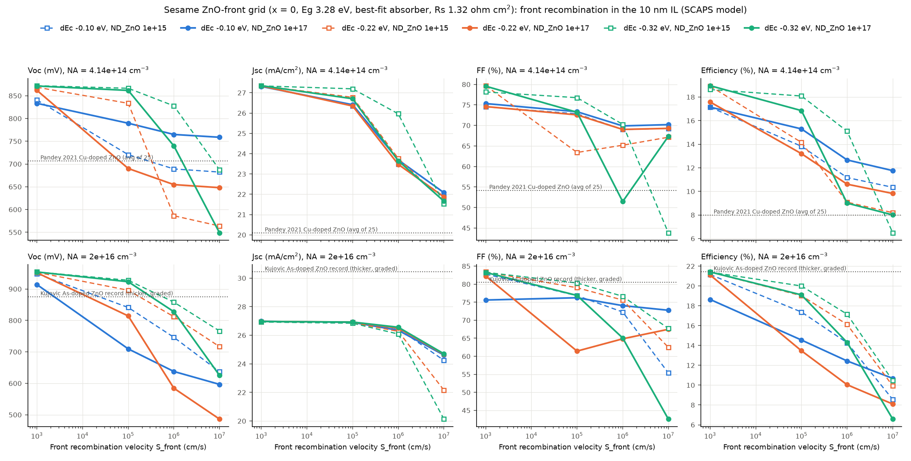
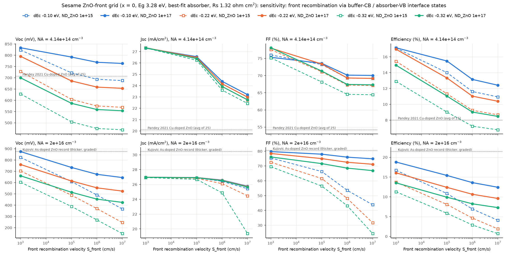

# Sesame drift-diffusion model of the option-A CdSeTe/CdTe cell (ZnO / MgZnO front)

This is a NIST Sesame 2.0 re-implementation of the SCAPS model that `optionA/mzo_model.py` writes. It is first
validated against SCAPS on the cases SCAPS solves. It is then run on the 48-case ZnO grid from
`optionA/zno_hypotheses.py`, where SCAPS failed on 42 cases.

Bottom line:
- **Validation:** with SCAPS's own optics, Sesame reproduces all 8 converged SCAPS cases to within 1.1 mV in Voc,
  0.22% in Jsc, 0.07 points in FF and 0.03 points in efficiency.
- **Convergence:** all 48 grid cases converge in Sesame, and so do all 48 cases of a second front-recombination
  variant.
- **How front recombination is represented decides the answers.** SCAPS's model puts it in a 10 nm absorber-side
  interface layer (IL). There it cannot exchange electrons with the ZnO conduction band, so a deeper cliff starves it
  of electrons. The trends with cliff depth then come out wrong (not monotonic, and often "deeper is better"). The
  grid was therefore also run with interface states that couple the ZnO conduction band to the absorber valence band
  (`grid.py --interface`). That variant gives the textbook behaviour and reproduces the calibrated x = 0.15 cell
  identically (844.5 against 844.4 mV).
- **Question 1 (do a deeper cliff and/or high S_front reproduce the Cu-doped ZnO cells?): no, in either
  representation.**
  - Voc 707 mV is reachable in several ways.
  - At NA 4.14e14, FF stays ≥ 64% with interface states. With the IL it stays ≥ 63%, except in two kinked cases
    (44% and 51%).
  - Jsc stays ≥ 21.5 mA/cm².
  - The measured FF of 54% and Jsc of 20.1 need a loss mechanism outside this grid.
- **Question 2 (does As-level NA 2e16 rescue the ZnO front?): only in the IL representation.**
  - With the IL, it helps in 11 of 12 cases with resistive ZnO.
  - With interface states, it helps in only 3 of 24 cases, all at the −0.10 eV cliff with ND_ZnO 1e17. Higher NA
    weakens the front inversion and feeds holes to the interface.
  - The one interface-state case that looks like Kujovic's cell (874 mV, FF 79.7%) needs S_front ≈ 1e3 cm/s. That
    points to a clean, shallow-cliff interface, not to doping rescuing a defective one.

## Files

| File | What it is |
|---|---|
| `sesame_cell.py` | Model builder: layer stack from the `mzo_model.py` priors, SCAPS `.def` reader and cross-check, SCAPS-rule optics, mesh, Sesame system, J-V sweep, loss bookkeeping, SCAPS-style Voc/Jsc/FF/eta with Rs. |
| `validate.py` → `validation.csv`, `validation_jv_curves.csv`, `validation_jv.png` | Step 1: 8 SCAPS cases × 3 optics variants. `--numerics` → `validation_numerics.csv` (mesh, tolerance and step checks). |
| `grid.py` → `grid_results.csv`, `grid_jv_curves.csv`, `grid_summary.png` | Step 2: the 48 ZnO cases, SCAPS model (front recombination in the IL). |
| `grid.py --interface` → `grid_results_interface.csv`, `grid_jv_curves_interface.csv`, `grid_summary_interface.png` | The same 48 cases with front recombination through interface states (buffer conduction band to absorber valence band, same S_front). Also two reference rows: the x = 0.15 and x = 0 best-fit cells. |
| `diagnose.py` → `diagnose.csv`, `diagnose_bands.png` | Band diagrams near the MPP, and carrier densities at the front interface layer, for 8 representative cases. |

Run any script with `../../.venv/bin/python <script>` from this folder. Each run is single-process and takes 4–15 s per J-V curve.

## Model: what is identical to SCAPS

Every case is built from the `mzo_model.P` priors with the same formulas as `mzo_model.build()`. Before
running, the case is compared parameter by parameter with the SCAPS `.def` (`sesame_cell.compare_with_def`).
All 8 validation cases and all 48 grid cases matched.

| Layer (front → back) | d | Eg / χ (eV) | ε | Nc / Nv (cm⁻³) | μn / μp (cm²/Vs) | doping | recombination |
|---|---|---|---|---|---|---|---|
| FTO | 0.5 µm | 3.6 / 4.0 | 9.0 | 2.2e18 / 1.8e19 | 100 / 25 | ND 1e20 | none |
| buffer (ZnO / MgZnO) | 100 nm | 3.28 or min(Eg, 3.5) / 4.00 − ΔEc | 9.0 | 2.2e18 / 1.8e19 | 100 / 25 | ND_buf | none |
| IL (CdSeTe) | 10 nm | 1.40 / 4.00 | 9.4 | 8e17 / 1.8e19 | 320 / 40 | NA | midgap SRH, τ_IL = d/S_front |
| CdSeTe | 0.49 µm | 1.40 / 4.00 | 9.4 | 8e17 / 1.8e19 | 320 / 40 | NA | midgap SRH, τ |
| CdTe | 3.0 µm | 1.50 / 3.90 | 9.4 | 8e17 / 1.8e19 | 320 / 40 | NA | midgap SRH, τ |

- **SRH:** τn = τp = 1/(Nt σ vth), with σ 1e-13 cm² and vth 1e7 cm/s. SCAPS puts the neutral level at Ev + Eg/2. Sesame measures E_t from the intrinsic level, so E_t = −(kT/2) ln(Nv/Nc) = −40.3 meV puts it at the same energy.
- **No other recombination:** radiative and Auger recombination are zero, as in the `.def`.
- **Front recombination:** carried by the 10 nm IL, exactly as in SCAPS: Nt_IL = S/(σ vth d), so τ_IL = d/S. No Sesame planar defect is used.
- **Back contact:** Schottky with work function φ_back and Sn = Sp = 1e7 cm/s, as in SCAPS (no flat band).
- **Front contact:** Sesame "Ohmic" with Sn = Sp = 1e7 cm/s, a Dirichlet condition with n = ND (Boltzmann).
  - Correction found later in `kujovic/`: these `.def`s say `flatband : 1` but `recalculate : 0`, so SCAPS actually
    used the stored Fi_m of 4.10 eV. On this FTO (χ 4.0) that is a 0.2 eV depletion contact, not exactly flat band.
  - The Ohmic front still reproduces SCAPS's front-contact hole loss (0.514 against 0.516 mA/cm²) and every
    validation metric, so the difference is negligible here.
  - On the Kujovic stack (FTO χ 4.5) the same rule matters: about 1.4% of Jsc.
- **Statistics:** both codes use Boltzmann statistics, including in the 1e20 cm⁻³ FTO (above Nc).
- **Series resistance:** applied as SCAPS does. The sweep is in internal voltage, and V_ext = V_int − J·Rs (generator convention). Jsc is J at V_ext = 0, Voc is where J = 0, and FF and eta come from max(V_ext·J). Applying our extraction routine to SCAPS's own curves reproduces SCAPS's printed values to within 0.01 mV and 0.004 FF points (`*_scaps_reext` columns).
- **Spectrum:** the SCAPS AM1.5G file (`physics/sq_limit.load_spectrum`), with photon flux 5.035e15·λ·P per bin, as in SCAPS.

## Deviations from SCAPS, and why

1. **Optics: SCAPS's filter semantics, found by matching SCAPS's generation.** The task said to start with one
   pass and no reflection. That overshoots: Sesame's generation is 30.88 mA/cm² against SCAPS's
   `j_total_gen` of 28.00, so Jsc comes out 10.3–10.4% high and Voc 3.5–5.5 mV high (rows `optics = single`).
   Reflections were therefore added. SCAPS uses Eq. 15 of its manual: T_front at the illuminated contact, R_back at
   the back contact, one reflected pass, and Rint = 0.
   - **Front:** the 10% file is declared as a *reflection* filter, so T_front = 0.9.
   - **Back:** the 80% file is declared in the `.def` as a *transmission* filter (`optical filter : transmission`).
     SCAPS therefore applies R_back = 0.2, not 0.8.
   - **Evidence:**

     | Optics | Generation (mA/cm²) | vs SCAPS's 28.003 | Jsc |
     |---|---|---|---|
     | T 0.9, R_back 0.2 | 27.983 | −0.07% | within 0.22% |
     | T 0.9, R_back 0.8 (literal "80% mirror") | 28.549 | +1.9% | 1.8–2.0% high (rows `mirror80`) |
     | T 1, R 0 | 30.88 | +10.3% | 10.3–10.4% high |

   - **Absorption:** α(λ) uses SCAPS's rule of logarithmic interpolation, with logarithmic extrapolation that may not
     rise away from the table (SCAPS manual §3.5.5.3 and §3.5.6.1). Linear interpolation would shift generation by
     about 0.1 mA/cm².
   - **Generation per node:** each node gets the exact Beer–Lambert photon absorption in its control volume. The
     discrete generation therefore integrates to the optical total, minus 0.0007 mA/cm² in the two half-cells at
     the contacts.
   - **Residual gap:** 0.021 mA/cm² (0.07%) of generation remains unexplained. It is probably SCAPS's quadrature of
     G(x) on its own mesh, which we cannot inspect.
   - **Buffer and FTO absorb, and carriers generated there count, as in SCAPS:** these layers have no recombination
     centres. Holes made in the buffer drift into the absorber, and holes made in the FTO split between the junction
     and the front contact. Sesame loses 0.514 mA/cm² of holes to the front contact; SCAPS's `jminor_right` is
     0.516–0.518.
2. **Heterointerfaces: drift-diffusion, not thermionic emission.** Sesame has no interface transport model. Band
   offsets are abrupt property changes between two nodes 0.02 nm apart, and carriers cross by Scharfetter–Gummel
   drift-diffusion. That is effectively an infinite interface velocity with continuous quasi-Fermi levels. SCAPS
   uses thermionic emission with vth = 1e7 cm/s. At these offsets (+0.19 to −0.10 eV in validation) the
   difference stays within the Voc and recombination agreement below.
3. **No-recombination layers:** Sesame needs a finite lifetime, so FTO and buffer use τ = 1 s. That is a diffusion
   length of about 0.8 cm against 0.6 µm of material, so it is equivalent to SCAPS's no defects.
4. **Terminal current:** computed as J = J_n(back contact) + J_p(front contact) + Σ(G − R)Δx. This uses only local
   quantities, so it avoids the cancellation that link currents suffer in the 1e20 FTO. Sesame's link current is
   kept as a check; it agrees to < 0.01 mA/cm².
5. **Voltage grid:** steps of 0.01 V in internal voltage, as SCAPS uses. The sweep stops three points past Voc.
   Failed Newton steps are bisected, and the generation is ramped in at V = 0 (see the convergence section).
6. **Extra, not in SCAPS (sensitivity only): `grid.py --interface`.** This variant replaces the IL by interface states
   at the buffer/absorber boundary, with the same S_front.
   - The states take electrons from the **buffer** conduction band and holes from the **absorber** valence band, using
     a two-node SRH rate with equal capture and the level at mid interface gap.
   - It is implemented by subclassing Sesame's solver (`sesame_cell._IFSolver`), which adds the rate to the
     residual and the Jacobian. Sesame's source is not changed.
   - **Checks:** the terminal current and Sesame's link current agree to < 3e-7 mA/cm². Newton converges without any
     extra retries or step bisections, same as the IL runs.
   - It is not used for validation or for the main grid. It exists because the IL cannot represent the cliff
     mechanism (see "Caveat").

## Step 1: validation against SCAPS (optics T_front 0.9, R_back 0.2)

| Case | SCAPS file | Voc S / SCAPS (mV) | Jsc S / SCAPS (mA/cm²) | FF S / SCAPS (%) | eta S / SCAPS (%) | ΔVoc (mV) | ΔJsc | ΔFF | Δeta |
|---|---|---|---|---|---|---|---|---|---|
| (a) MgZnO x 0.15, +0.19 spike, best fit | x0p15_lhs0220 | 844.4 / 843.4 | 27.262 / 27.279 | 75.06 / 75.01 | 17.28 / 17.26 | +1.0 | −0.06% | +0.05 | +0.02 |
| (b) ZnO −0.10, S 1e5, ND 1e15 | x0p00_h004 | 720.5 / 719.7 | 26.350 / 26.359 | 72.84 / 72.83 | 13.83 / 13.82 | +0.8 | −0.03% | +0.01 | +0.01 |
| (b) ZnO −0.10, S 1e5, ND 1e17 | x0p00_h006 | 789.6 / 788.8 | 26.412 / 26.420 | 73.34 / 73.33 | 15.30 / 15.28 | +0.8 | −0.03% | +0.01 | +0.01 |
| (b) ZnO −0.10, S 1e6, ND 1e15 | x0p00_h008 | 689.1 / 688.6 | 23.487 / 23.538 | 69.00 / 69.06 | 11.17 / 11.19 | +0.5 | −0.22% | −0.06 | −0.03 |
| (b) ZnO −0.10, S 1e6, ND 1e17 | x0p00_h010 | 764.9 / 764.4 | 23.692 / 23.739 | 69.89 / 69.96 | 12.66 / 12.69 | +0.5 | −0.20% | −0.07 | −0.03 |
| extra: ZnO −0.10, S 1e3, ND 1e15 | x0p00_h000 | 840.7 / 839.6 | 27.338 / 27.355 | 74.54 / 74.49 | 17.13 / 17.11 | +1.1 | −0.06% | +0.05 | +0.02 |
| extra: ZnO −0.10, S 1e3, ND 1e17 | x0p00_h002 | 833.3 / 832.3 | 27.311 / 27.328 | 75.33 / 75.28 | 17.15 / 17.12 | +1.0 | −0.06% | +0.05 | +0.02 |
| extra: ZnO −0.10, x 0 best fit | x0p00_lhs0220 | 836.1 / 835.1 | 27.231 / 27.247 | 74.98 / 74.93 | 17.07 / 17.05 | +1.0 | −0.06% | +0.05 | +0.02 |

S = Sesame. Case (a) uses LHS sample 220 at full precision (τ 7.2428 ns, NA 4.1394e14, φ_back 5.27098 eV,
S_front 7511 cm/s, ND 6.4717e17, Rs 1.31599 Ω cm²). The (b) cases use the rounded best fit, as
`zno_hypotheses.py` does.

**Agreement:** it is two orders of magnitude inside the target of 1–2% in Jsc and 10–20 mV in Voc.
- **Whole curves:** below the MPP, |ΔJ| at fixed voltage is ≤ 0.07 mA/cm². Between the MPP and Voc, |ΔV| at fixed
  current is ≤ 1.4 mV (`maxdJ_below_Vmpp_mAcm2`, `maxdV_Vmpp_to_Voc_mV`).
- **Loss components at V_int = 0 agree with SCAPS's own breakdown:**

  | Component | Sesame | SCAPS |
  |---|---|---|
  | Bulk + IL recombination (S 1e5, ND 1e15) | 1.056 | 1.065 (`jbulk`) |
  | Bulk + IL recombination (S 1e6, ND 1e15) | 3.888 | 3.855 |
  | Front-contact hole loss | 0.514 | 0.516 |
  | Back-contact electron loss | 0.0264 | 0.0262 |

**Remaining differences:**
- Jsc is 0.03–0.06% low at S ≤ 1e5, which is the 0.07% generation gap above. At S = 1e6 it is 0.2% low, because
  Sesame's IL recombines 0.03 mA/cm² (0.9%) more. That is the size expected from drift-diffusion against
  thermionic transport across the −0.10 eV cliff into the IL, or from SCAPS's mesh in the 10 nm IL. We cannot
  separate the two without SCAPS's mesh.
- Voc is 0.5–1.1 mV high. It is not optics: the 0.07% lower generation would lower Voc by about 0.02 mV. It is most
  likely the same interface/discretisation difference; this was not isolated.
- FF and eta differences are ≤ 0.07 and ≤ 0.03 points.

### Numerical checks (`validate.py --numerics` → `validation_numerics.csv`)

Five cells were rerun: the spike cell (a), the worst validated cliff cell (S 1e6, ND 1e15), and grid cases 42, 44
and 47 (deep cliff, high S, kinked curves). Each change is measured against the 535-node baseline.

| Variant | Largest change in Voc | Jsc | FF | eta |
|---|---|---|---|---|
| Mesh 2× finer (854 nodes) | 0.49 mV (case 42) | 0.007 mA/cm² | 0.03 | 0.007 |
| Mesh 4× finer (1492 nodes) | 0.74 mV (case 42) | 0.012 mA/cm² | 0.04 | 0.011 |
| Mesh 2× coarser (375 nodes) | 1.01 mV (case 42) | 0.011 mA/cm² | 0.05 | 0.014 |
| Newton tolerance 1e-10 (from 1e-8) | < 1e-6 mV | < 1e-9 | < 1e-8 | < 1e-8 |
| Voltage step 0.005 V (from 0.01) | 0.005 mV | < 1e-7 | 0.0004 | 0.0001 |

- The validated cells are mesh-converged to < 0.03 mV.
- The kinked grid cells are converged to < 1 mV and < 0.05 FF points, so their low FF is not a numerical artifact.

## Step 2: the ZnO grid SCAPS could not solve (x = 0, Eg 3.28 eV, Rs 1.32 Ω cm²)

All 48 cases converged in Sesame (`grid_results.csv`). Each is checked against the `.def` that SCAPS failed on.
For the 6 cases SCAPS did solve (h000–h010), the grid reproduces the validation numbers above.

Voc in mV, Jsc in mA/cm², FF and eta in %. "IL" is the SCAPS model, with front recombination in the 10 nm interface layer. "Interface states" is the sensitivity variant described below. The SCAPS column lists the 6 cases SCAPS solved; the IL column reproduces them to within 1.1 mV.

| # | ΔEc | S_front | ND_ZnO | NA | IL: Voc / Jsc / FF / eta | interface states: Voc / Jsc / FF / eta | SCAPS |
|---|---|---|---|---|---|---|---|
| 0 | -0.10 | 1e+03 | 1e+15 | 4.14e+14 | 840.7 / 27.34 / 74.5 / 17.13 | 823.0 / 27.34 / 76.0 / 17.10 | 839.6 / 27.36 / 74.5 / 17.11 |
| 1 | -0.10 | 1e+03 | 1e+15 | 2e+16 | 948.4 / 26.95 / 82.8 / 21.16 | 822.6 / 26.95 / 75.4 / 16.72 | failed |
| 2 | -0.10 | 1e+03 | 1e+17 | 4.14e+14 | 833.3 / 27.31 / 75.3 / 17.15 | 833.2 / 27.31 / 75.3 / 17.14 | 832.3 / 27.33 / 75.3 / 17.12 |
| 3 | -0.10 | 1e+03 | 1e+17 | 2e+16 | 914.0 / 26.98 / 75.6 / 18.64 | 874.4 / 26.98 / 79.7 / 18.81 | failed |
| 4 | -0.10 | 1e+05 | 1e+15 | 4.14e+14 | 720.5 / 26.35 / 72.8 / 13.83 | 721.9 / 26.49 / 73.2 / 14.01 | 719.7 / 26.36 / 72.8 / 13.82 |
| 5 | -0.10 | 1e+05 | 1e+15 | 2e+16 | 841.2 / 26.90 / 76.8 / 17.38 | 608.6 / 26.88 / 66.3 / 10.84 | failed |
| 6 | -0.10 | 1e+05 | 1e+17 | 4.14e+14 | 789.6 / 26.41 / 73.3 / 15.30 | 792.0 / 26.56 / 73.6 / 15.47 | 788.8 / 26.42 / 73.3 / 15.28 |
| 7 | -0.10 | 1e+05 | 1e+17 | 2e+16 | 709.6 / 26.90 / 76.2 / 14.55 | 733.9 / 26.93 / 78.0 / 15.41 | failed |
| 8 | -0.10 | 1e+06 | 1e+15 | 4.14e+14 | 689.1 / 23.49 / 69.0 / 11.17 | 693.4 / 24.18 / 69.3 / 11.61 | 688.6 / 23.54 / 69.1 / 11.19 |
| 9 | -0.10 | 1e+06 | 1e+15 | 2e+16 | 746.3 / 26.46 / 72.3 / 14.28 | 489.5 / 26.43 / 53.6 / 6.93 | failed |
| 10 | -0.10 | 1e+06 | 1e+17 | 4.14e+14 | 764.9 / 23.69 / 69.9 / 12.66 | 768.8 / 24.38 / 70.1 / 13.15 | 764.4 / 23.74 / 70.0 / 12.69 |
| 11 | -0.10 | 1e+06 | 1e+17 | 2e+16 | 637.7 / 26.35 / 74.1 / 12.44 | 673.2 / 26.59 / 76.0 / 13.60 | failed |
| 12 | -0.10 | 1e+07 | 1e+15 | 4.14e+14 | 682.3 / 21.89 / 69.3 / 10.34 | 687.7 / 23.00 / 69.2 / 10.94 | failed |
| 13 | -0.10 | 1e+07 | 1e+15 | 2e+16 | 637.0 / 24.24 / 55.4 / 8.55 | 365.7 / 25.42 / 43.8 / 4.07 | failed |
| 14 | -0.10 | 1e+07 | 1e+17 | 4.14e+14 | 758.8 / 22.08 / 70.2 / 11.76 | 763.6 / 23.20 / 70.0 / 12.41 | failed |
| 15 | -0.10 | 1e+07 | 1e+17 | 2e+16 | 596.7 / 24.61 / 72.8 / 10.69 | 644.4 / 25.76 / 74.8 / 12.42 | failed |
| 16 | -0.22 | 1e+03 | 1e+15 | 4.14e+14 | 868.7 / 27.35 / 79.7 / 18.93 | 727.9 / 27.34 / 77.6 / 15.44 | failed |
| 17 | -0.22 | 1e+03 | 1e+15 | 2e+16 | 953.0 / 26.94 / 83.4 / 21.41 | 702.8 / 26.94 / 72.5 / 13.73 | failed |
| 18 | -0.22 | 1e+03 | 1e+17 | 4.14e+14 | 861.9 / 27.34 / 74.6 / 17.58 | 795.1 / 27.34 / 78.0 / 16.96 | failed |
| 19 | -0.22 | 1e+03 | 1e+17 | 2e+16 | 951.7 / 26.97 / 82.2 / 21.11 | 759.8 / 26.97 / 78.4 / 16.08 | failed |
| 20 | -0.22 | 1e+05 | 1e+15 | 4.14e+14 | 833.3 / 26.78 / 63.4 / 14.15 | 604.1 / 26.38 / 71.1 / 11.33 | failed |
| 21 | -0.22 | 1e+05 | 1e+15 | 2e+16 | 895.9 / 26.87 / 79.0 / 19.02 | 488.2 / 26.83 / 61.5 / 8.06 | failed |
| 22 | -0.22 | 1e+05 | 1e+17 | 4.14e+14 | 690.2 / 26.35 / 72.6 / 13.20 | 685.9 / 26.49 / 73.4 / 13.33 | failed |
| 23 | -0.22 | 1e+05 | 1e+17 | 2e+16 | 814.3 / 26.92 / 61.4 / 13.47 | 614.1 / 26.92 / 75.0 / 12.40 | failed |
| 24 | -0.22 | 1e+06 | 1e+15 | 4.14e+14 | 586.3 / 23.77 / 65.2 / 9.08 | 574.8 / 23.90 / 67.2 / 9.24 | failed |
| 25 | -0.22 | 1e+06 | 1e+15 | 2e+16 | 811.9 / 26.27 / 75.6 / 16.12 | 369.0 / 26.10 / 48.1 / 4.63 | failed |
| 26 | -0.22 | 1e+06 | 1e+17 | 4.14e+14 | 654.7 / 23.47 / 69.0 / 10.61 | 658.6 / 24.16 / 69.3 / 11.03 | failed |
| 27 | -0.22 | 1e+06 | 1e+17 | 2e+16 | 584.5 / 26.50 / 64.8 / 10.04 | 553.3 / 26.55 / 72.5 / 10.65 | failed |
| 28 | -0.22 | 1e+07 | 1e+15 | 4.14e+14 | 563.7 / 21.65 / 67.1 / 8.19 | 569.0 / 22.72 / 67.1 / 8.68 | failed |
| 29 | -0.22 | 1e+07 | 1e+15 | 2e+16 | 716.7 / 22.16 / 62.5 / 9.92 | 245.4 / 24.46 / 31.6 / 1.90 | failed |
| 30 | -0.22 | 1e+07 | 1e+17 | 4.14e+14 | 648.0 / 21.87 / 69.3 / 9.82 | 653.2 / 22.98 / 69.2 / 10.39 | failed |
| 31 | -0.22 | 1e+07 | 1e+17 | 2e+16 | 486.2 / 24.67 / 67.5 / 8.10 | 524.4 / 25.70 / 71.2 / 9.59 | failed |
| 32 | -0.32 | 1e+03 | 1e+15 | 4.14e+14 | 872.1 / 27.34 / 78.2 / 18.63 | 628.3 / 27.33 / 75.2 / 12.91 | failed |
| 33 | -0.32 | 1e+03 | 1e+15 | 2e+16 | 954.2 / 26.93 / 83.3 / 21.39 | 602.8 / 26.93 / 69.5 / 11.28 | failed |
| 34 | -0.32 | 1e+03 | 1e+17 | 4.14e+14 | 871.4 / 27.35 / 79.6 / 18.96 | 699.6 / 27.34 / 78.1 / 14.94 | failed |
| 35 | -0.32 | 1e+03 | 1e+17 | 2e+16 | 954.1 / 26.97 / 83.3 / 21.42 | 659.9 / 26.96 / 76.1 / 13.54 | failed |
| 36 | -0.32 | 1e+05 | 1e+15 | 4.14e+14 | 866.4 / 27.20 / 76.8 / 18.09 | 504.2 / 26.24 / 68.1 / 9.01 | failed |
| 37 | -0.32 | 1e+05 | 1e+15 | 2e+16 | 927.7 / 26.84 / 80.3 / 20.00 | 388.1 / 26.68 / 56.4 / 5.85 | failed |
| 38 | -0.32 | 1e+05 | 1e+17 | 4.14e+14 | 861.7 / 26.71 / 73.2 / 16.85 | 586.5 / 26.39 / 71.3 / 11.04 | failed |
| 39 | -0.32 | 1e+05 | 1e+17 | 2e+16 | 923.1 / 26.92 / 76.9 / 19.10 | 514.2 / 26.91 / 71.6 / 9.91 | failed |
| 40 | -0.32 | 1e+06 | 1e+15 | 4.14e+14 | 827.8 / 25.96 / 70.3 / 15.10 | 474.9 / 23.60 / 64.5 / 7.23 | failed |
| 41 | -0.32 | 1e+06 | 1e+15 | 2e+16 | 858.1 / 26.09 / 76.6 / 17.16 | 269.0 / 24.87 / 43.2 / 2.89 | failed |
| 42 | -0.32 | 1e+06 | 1e+17 | 4.14e+14 | 739.8 / 23.65 / 51.5 / 9.00 | 559.0 / 23.93 / 67.4 / 9.02 | failed |
| 43 | -0.32 | 1e+06 | 1e+17 | 2e+16 | 827.7 / 26.56 / 65.1 / 14.31 | 453.3 / 26.51 / 68.6 / 8.24 | failed |
| 44 | -0.32 | 1e+07 | 1e+15 | 4.14e+14 | 687.2 / 21.52 / 43.8 / 6.48 | 469.0 / 22.43 / 64.4 / 6.78 | failed |
| 45 | -0.32 | 1e+07 | 1e+15 | 2e+16 | 766.3 / 20.13 / 67.7 / 10.45 | 147.5 / 19.36 / 24.3 / 0.70 | failed |
| 46 | -0.32 | 1e+07 | 1e+17 | 4.14e+14 | 548.7 / 21.66 / 67.3 / 8.01 | 553.5 / 22.75 / 67.3 / 8.47 | failed |
| 47 | -0.32 | 1e+07 | 1e+17 | 2e+16 | 625.2 / 24.70 / 42.6 / 6.58 | 424.4 / 25.64 / 66.9 / 7.28 | failed |

### Mechanism: where the front recombination happens

`diagnose.py` and `diagnose_bands.png` show the mechanism. Two features of the SCAPS model set it.

**1. The FTO pins the ZnO conduction band near the Fermi level.**
- The FTO electron affinity (4.0 eV, SCAPS default) is smaller than the ZnO's (4.10–4.32 eV). Electrons
  therefore spill from the FTO into the ZnO, and the ZnO conduction band sits near E_F.
- A deeper cliff therefore does not lower the ZnO band. It raises the IL conduction band above E_F by about |ΔEc|.
- In equilibrium, Ec − E_F at the IL is (`diagnose.csv`):

  | Front | Ec − E_F at the IL (eV) |
  |---|---|
  | MgZnO spike | −0.03 (strongly inverted) |
  | ZnO −0.10, ND 1e15 | +0.31 |
  | ZnO −0.22, ND 1e15 | +0.42 |
  | ZnO −0.32, ND 1e15 | +0.52 |
  | ZnO −0.10, ND 1e17 | +0.20 |
  | NA 2e16 with ND 1e15 | +0.73 |
  | NA 2e16 with ND 1e17 | +0.38 |

**2. The IL is an SRH layer.** Its rate, (np − ni²)/(τ_IL(n + p)), peaks when n ≈ p in the IL at the operating
point. It is small both when the IL is strongly inverted (n ≫ p: the MgZnO spike, n 1e18 and p 1e10 cm⁻³) and when
the IL is starved of electrons (p ≫ n).
- At −0.32 eV and S 1e5 the IL holds n ≈ 4e10 against p ≈ 8e15 cm⁻³ at the MPP. Its recombination is limited by
  electrons and is small, so Voc rises from 720 mV (−0.10) to 866 mV (−0.32).
- At S ≥ 1e6 the IL passes through n ≈ p as the bias rises. That gives the kinked J-V curves and the FF of 44–51%
  in cases 42 and 44.
- The kinks are numerically converged: they are unchanged with a 2× and 4× finer mesh and a 100× tighter Newton
  tolerance (`validation_numerics.csv`).

**Caveat: the cliff trend is an artifact of the IL representation.** It is not a robust prediction.
- In the IL (SCAPS's choice here), the front defects exchange electrons only with the absorber conduction band,
  which lies |ΔEc| above the ZnO band. A deeper cliff therefore starves them of electrons.
- Real interface states at a ZnO/CdSeTe interface also capture electrons from the ZnO conduction band. That is the
  textbook cliff mechanism: activation energy Eg − |ΔEc|, and a deeper cliff makes it worse.
- Neither SCAPS's IL nor a Sesame planar defect (one node, local n and p) contains this channel. A sensitivity run
  with a two-sided interface defect is reported below.

### Sensitivity: front recombination through interface states (`grid.py --interface`)

This runs the same 48 cases with the same S_front values. The IL becomes plain CdSeTe with the bulk τ, and S_front is
carried by interface states at the ZnO/CdSeTe boundary. The states capture electrons from the ZnO conduction band
and holes from the absorber valence band, with the level at mid interface gap. The interface gap is
1.40 − |ΔEc|: 1.30, 1.18 and 1.08 eV.

**Where the two representations agree:** where the front is inverted, or the cliff is shallow and S low, they
give the same cell.

| Cell | Interface states | IL |
|---|---|---|
| Best-fit x = 0.15 spike cell | 844.5 mV / 27.27 / 75.1 / 17.29% | 844.4 / 27.26 / 75.06 / 17.28 |
| x = 0 best fit | 836.4 mV | 836.1 mV |
| −0.10 eV, S 1e5, ND 1e15 | 721.9 mV | 720.5 mV |

The x = 0.15 calibration therefore does not depend on this choice.

**Deep cliffs, high S and high NA:** here the representations part.
- **Voc falls with cliff depth in all 16 (S, ND_ZnO, NA) series.** It falls about 1 mV per meV of cliff, so it
  tracks the interface gap, as interface-limited Voc should. For example, at NA 4.14e14, ND 1e15 and S 1e5: 722,
  604 and 504 mV for −0.10, −0.22 and −0.32 eV.
- **ND_ZnO 1e17 gives higher efficiency than 1e15 in all 24 (ΔEc, S, NA) pairs.** The stronger inversion keeps
  holes away from the interface.
- **NA 2e16 is worse than 4.14e14 in 21 of 24 pairs.** With resistive ZnO the FF collapses to 24–66% at
  S ≥ 1e5.

The terminal current, built from ΣG − ΣR − U_interface, agrees with Sesame's link current to < 3e-7 mA/cm² in
every case. This confirms that the added rate is consistent between the residual and the current bookkeeping. This variant has no SCAPS counterpart in this project, so it is a sensitivity result, not a
validated one.

### Question 1: do a deeper cliff and/or high S_front reproduce the Cu-doped ZnO cells?

Target: 707 mV, 20.1 mA/cm², 54.2%, 8.0% (Pandey et al. 2021, average of 25 cells); NA = 4.14e14.

- **At the measured cliff (−0.10 eV), high S alone is not enough.** From S 1e3 to 1e7 cm/s, Voc falls from 841 to
  682 mV (ND 1e15) or from 833 to 759 mV (ND 1e17), and Jsc falls to 21.9–22.1. But FF stays at 69–75% and eta at
  10.3–11.8%. The FF collapse to 54% is not reproduced.
- **Jsc is set by S, almost independently of the cliff.** At S = 1e7 the IL loses 5.2–5.7 mA/cm² at short circuit.
  The lowest Jsc anywhere at NA 4.14e14 is 21.5. The measured 20.1 is below every case, so an additional ~1.5 mA/cm²
  loss (optical or collection) is needed in any explanation.
- **Only a deep cliff plus high S brackets the measured cells:**

  | Case | Voc (mV) | Jsc (mA/cm²) | FF (%) | eta (%) |
  |---|---|---|---|---|
  | −0.32 eV, S 1e6, ND 1e17 | 740 | 23.7 | 51.5 | 9.0 |
  | −0.32 eV, S 1e7, ND 1e15 | 687 | 21.5 | 43.8 | 6.5 |
  | Measured (Pandey 2021) | 707 | 20.1 | 54.2 | 8.0 |

  These two cases bracket the measured Voc, FF and eta, but Jsc stays high. The low FF comes from the
  n ≈ p kink described above, which hinges on how the IL represents front recombination.
- **Answer:** within the SCAPS model, the measured −0.10 eV cliff plus any S does not reproduce the ZnO cells. Only the
  deepest cliff (−0.32 eV, the Loughborough film value) with S ≥ 1e6 cm/s comes close, and Jsc is still 1.4–3.6
  mA/cm² high.
- **With interface states (the textbook cliff mechanism) the answer is also no.** At NA 4.14e14 a deeper cliff
  lowers Voc steadily, and 707 mV is crossed at several points:

  | Cliff, ND_ZnO | S_front where Voc ≈ 707 mV |
  |---|---|
  | −0.10 eV, ND 1e15 | between 1e5 and 1e6 cm/s |
  | −0.22 eV, ND 1e15 | just above 1e3 cm/s |
  | −0.22 eV, ND 1e17 | between 1e3 and 1e5 cm/s |
  | −0.32 eV, ND 1e17 | about 1e3 cm/s |

  The grid points that bracket those crossings have Jsc 24.2–27.3 mA/cm², FF 69–78% and eta 11.6–17.0%. Across
  the whole NA 4.14e14 set, FF never falls below 64% and Jsc never below 22.4.
- **Overall:** a deeper cliff can explain the Voc loss, and a high S can explain part of the Jsc loss. Neither,
  nor both together, gives FF 54% at Jsc 20 mA/cm². The measured cells need a further mechanism that this grid does
  not contain and that we have not tested. Candidates are a transport barrier, shunting, a Cu-related absorber
  change, or an optical or collection loss in the ZnO cells.

### Question 2: does As-level doping (NA 2e16) rescue the ZnO interface?

Compare trends, not absolutes: Kujovic's 21.44% device (875.5 mV, 30.43 mA/cm², 80.48%) is thicker and graded.

**With the IL (SCAPS model):**

- **Resistive ZnO (ND 1e15): yes, in 11 of 12 (ΔEc, S) pairs.**
  - Efficiency rises by 1.7–7.0 points and Voc by 30–226 mV.
  - At S ≤ 1e5 the cells reach 17.4–21.4% with FF 77–83%. At S = 1e6 they keep 14.3–17.2%, against 9.1–15.1% at
    NA 4.14e14.
  - Jsc becomes almost insensitive to S up to 1e6 (26.1–26.5 against 23.5–26.0). The stronger front field cuts the
    IL loss at short circuit from 1.4–3.8 to 0.5–0.8 mA/cm².
  - The exception is −0.10 eV with S 1e7: 8.6% against 10.3%.
- **Conductive ZnO (ND 1e17): only 6 of 12.**
  - At −0.10 eV and S ≥ 1e5 the higher NA lowers Voc: 710 vs 790 mV at 1e5, 638 vs 765 at 1e6, 597 vs 759 at 1e7.
  - The reason is that with ND 1e17 the IL sits nearer the n ≈ p maximum (Ec − E_F = 0.38 eV, against 0.73 eV with
    resistive ZnO).
- **At S = 1e7 nothing rescues the cell:** 6.6–10.7%.
- **Absolute values differ from Kujovic, as expected:** our As-level cells at S 1e3 reach 914–954 mV and Jsc
  26.9–27.0 against 875.5 mV and 30.43. Our absorber is thinner with no Se grading, the front reflection is 10%, and our
  lifetime and NA are not Kujovic's.

**With interface states (sensitivity):**

- **NA 2e16 raises efficiency in only 3 of 24 pairs.** All three are at the −0.10 eV cliff with ND_ZnO 1e17:
  18.81 vs 17.14% at S 1e3, then 13.60 vs 13.15 and 12.42 vs 12.41 at 1e6 and 1e7.
- **Resistive ZnO with As-level doping is the worst combination:** 0 of 12 improve, and FF falls to 24–66% at
  S ≥ 1e5.
- **Why:** higher NA weakens the inversion at the front. In equilibrium, Ec − E_F at the interface rises from 0.31
  to 0.73 eV for ND 1e15 (`diagnose.csv`). More holes reach the interface, and with the ZnO electrons available,
  interface recombination rises.
- **The one Kujovic-like cell:** −0.10 eV, S 1e3, ND 1e17, NA 2e16 gives 874 mV / 27.0 mA/cm² / 79.7% / 18.8%,
  close to Kujovic's 875.5 mV and 80.5% FF (Jsc is lower for the optical reasons above).

**Answer:** it depends on how front recombination is modelled, so the grid alone cannot settle it.
- With SCAPS's IL, As-level doping rescues a resistive-ZnO front up to S ≈ 1e5–1e6 cm/s.
- With interface states that see the ZnO electrons, which is the physically expected channel at a cliff, it does
  not. A high-NA absorber then needs a clean interface (S ≲ 1e3 cm/s), a shallow cliff and a conductive buffer.
- Kujovic's 21.4% with resistive ZnO fits the IL reading for S up to about 1e5 cm/s.
- Under the interface-state reading it needs more than our best case gives. Resistive ZnO at S 1e3 with the
  −0.10 eV cliff reaches only 823 mV and 75.4% here, so it needs S < 1e3 cm/s or a flatter band alignment than
  −0.10 eV (UPS on ZnO/CdTe suggests about 0).
- The conservative reading is that Kujovic's result reflects a well-passivated, nearly flat ZnO/CdSeTe interface,
  not a doping rescue of a defective one.
- Measuring the ZnO/CdSeTe interface recombination velocity (or the cliff depth on device stacks) would decide
  between the two.

## Convergence

**Sesame converged in every run:** all 24 validation runs, all 48 IL grid cases, all 48 interface-state cases and the
two reference cells. None failed, and no number in this folder comes from an unconverged point.

How each J-V curve is computed (`sesame_cell.run_jv`):
1. **Equilibrium:** a Poisson solve from a local-charge-neutrality initial guess. Contact potentials are set by the
   Ohmic and Schottky conditions.
2. **Light at V = 0:** generation is ramped in at 1e-8, 1e-6, 1e-4, 1e-3, 1e-2, 0.03, 0.1, 0.3, 0.6 and 1 sun. If a
   Newton solve fails, an intermediate intensity is inserted. Sesame prints "Newton-Raphson algorithm diverged"
   for those attempts; they are expected and harmless. Every run needed 8 insertions, all on the first ramp
   steps.
3. **Forward sweep:** 0.01 V steps, with a linear predictor from the two previous solutions. A failed step is retried
   without the predictor, then bisected down to 1e-4 V. No run in this folder needed a retry or a bisection
   (`predictor_fallbacks` and `step_halvings` are 0 in every CSV row).
4. **Newton tolerance:** the largest update must fall below 1e-8 kT. Sesame's default is 1e-6. At 1e-6, the last
   unapplied update can shift the link current in the 1e20 FTO by tens of A/cm², which is why the terminal current
   is built from G − R instead.

**Mesh:** 535 nodes. The smallest spacing is 0.021 nm, at the FTO/buffer interface (where the FTO Debye length is
0.36 nm) and at the buffer/IL interface. Spacing grows 15% per node up to 10 nm in FTO, 2 nm in the buffer,
0.5 nm in the IL, 10 nm in CdSeTe and 20 nm in CdTe.

**Wall time:** 4–15 s per J-V curve, single process, on a machine with load average 6–55 from other jobs.

**Why SCAPS failed:** that was not diagnosed here. Sesame solves for the quasi-Fermi levels and the potential in
kT units, so it never forms the tiny minority densities directly (about 1e-43 cm⁻³ holes in the FTO). That is one
plausible reason it copes where SCAPS reported non-convergence, but we have not tested it.

**Limitations shared with SCAPS:**
- Boltzmann statistics in the degenerate FTO and in the electron-accumulated ZnO.
- SCAPS's default FTO electron affinity (4.0 eV), which makes electrons spill from the FTO into the ZnO.
- In the IL representation, the front defects cannot reach the ZnO electrons.
