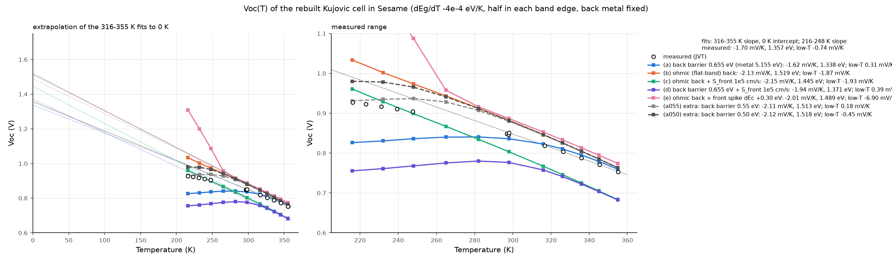

# Rebuilt Kujovic 21.4% cell in Sesame (SCAPS not run)

This folder runs the rebuilt Loughborough 21.4% cell in Sesame instead of SCAPS. SCAPS stopped launching, so
nothing here runs it.

- **Inputs:** every case is read from the SCAPS `.def` that `optionA/kujovic_model.py` writes.
- **Voc(T) defs:** written by `optionA/kujovic_vocT.build_T`, with the output redirected into `./defs` and
  `./absorption`. Nothing under `scaps/` was written.
- **Shared machinery:** the solver, optics (T_front 0.9, R_back 0.2, SCAPS α rules), current bookkeeping and metrics
  are those of `../sesame_cell.py`, validated against SCAPS in `../README.md`.
- **Series resistance:** Rs = 0 throughout, as in the SCAPS runs.

| File | What it is |
|---|---|
| `kj_sesame.py` | `.def` reader for this 7-layer stack, mesh, temperature-dependent Sesame cell, small-signal EQE |
| `run_kujovic.py validate / configs / vocT / plot` | the three steps below and the figures |
| `kujovic_validation.csv` | Step 0 |
| `kujovic_configs.csv`, `kujovic_configs_jv.csv`, `kujovic_eqe.csv`, `kujovic_configs.png` | Step A |
| `kujovic_vocT.csv`, `kujovic_vocT_fits.csv`, `kujovic_vocT.png` | Step B |

## What the `.def` reader does

- **Defects:** every SRH block of a layer is read. All blocks here are neutral, midgap and have σn = σp (the reader
  checks this), so they combine into 1/τ = Σ Nt σ vth. The IL gets τ = 9.9e-11 s: bulk 10 ns plus the S_front
  1e4 block.
- **Window defects:** only in `*_win`. They give τ = 10 ns in ZnO and 1 ns in FTO. Elsewhere the FTO and ZnO have
  no recombination.
- **Back contact:** flat band (Sesame Ohmic, p = NA with the temperature's Nv) only when the `.def` says
  `flatband : 1` **and** `recalculate : 1`. Otherwise the stored Fi_m is used: 5.155 eV in the barrier configs, and
  5.0 eV in `K_u_base` (flatband 1 but recalculate 0). In the CSVs, "Ohmic 5.0" means flat band; the stored 5.0 eV
  is not used.
- **Front contact, same rule (this differs from the note I was given):** the front is `flatband : 1`,
  `recalculate : 0`, so SCAPS uses the stored Fi_m of 4.10 eV.
  - On FTO with χ 4.5 that is a 0.4 eV electron-accumulation contact. Its field repels holes that are generated in
    the FTO and ZnO.
  - A plain Ohmic front lets 0.37 mA/cm² of those holes recombine at the contact. SCAPS's `jminor_right` is only
    0.0017 mA/cm², so the Ohmic front makes Jsc 1.4% too low.
  - With the stored 4.10 eV, Sesame gives 0.0016 mA/cm². All runs below use the stored value.
- **Temperature:** Nc and Nv scale as (T/300)^1.5. Mobilities and vth stay constant. The gap shift, band-edge
  split, shifted absorption files and back-metal work function come from the `build_T` defs.

## Step 0: validation against the two existing SCAPS results (300 K)

| Case | Sesame Voc / Jsc / FF / eta | SCAPS | Δ |
|---|---|---|---|
| K_u_backPhi581 | 878.6 / 27.985 / 82.26 / 20.23 | 878.4 / 28.015 / 82.24 / 20.24 | +0.2 mV, −0.11%, +0.03, −0.01 |
| K_u_base (0.81 eV back barrier) | 685.4 / 27.867 / 64.23 / 12.27 | 685.8 / 27.897 / 64.26 / 12.30 | −0.4 mV, −0.11%, −0.04, −0.03 |

Loss terms at V = 0 (mA/cm²):

| Term | Sesame | SCAPS |
|---|---|---|
| Generation | 28.225 | 28.256 |
| Bulk recombination (backPhi581 / base) | 0.223 / 0.242 | 0.224 / 0.243 |
| Back-contact electron loss (backPhi581 / base) | 0.0156 / 0.1143 | 0.0157 / 0.1144 |
| Front-contact hole loss | 0.0016 | 0.0017 |

The rows with an Ohmic front are kept in the CSV to show the 1.4% Jsc effect.

## Step A: the five configurations (300 K)

| Config | Voc (mV) | Jsc (mA/cm²) | FF (%) | eta (%) | EQE integral, 320–960 nm (mA/cm²) |
|---|---|---|---|---|---|
| graded_flat | 878.3 | 27.92 | 82.23 | 20.17 | 27.81 |
| graded_bar0655 | 835.0 | 27.90 | 69.88 | 16.28 | 27.77 |
| uniform_bar0655 | 842.9 | 27.46 | 70.32 | 16.27 | 27.33 |
| uniform_flat | 904.0 | 27.52 | 80.74 | 20.09 | 27.40 |
| graded_bar0655_win | 834.8 | 27.63 | 69.88 | 16.12 | 27.55 |
| authors' SCAPS | 872 | 30.8 | 79.6 | 21.4 | |
| measured | 875.5 | 30.43 | 80.48 | 21.44 | 27.69 (EQE) |

- **Only the flat-band back fits the measured J-V shape.** graded_flat gives Voc +2.8 mV and FF +1.8 points
  against the measurement. The 0.655 eV barrier costs about 43 mV and 12 FF points (FF 70% against 80.5%).
  uniform_flat overshoots Voc by 28 mV.
- **Jsc:** every config gives 27.5–27.9, 2.5–3.3 mA/cm² below the J-V Jsc. But the measured EQE itself integrates
  to only 27.69 mA/cm², and the model's EQE integrates to 27.3–27.8 (within 1.5% of it). The gap to 30.4–30.8 is
  between the measured J-V and the measured EQE, and in the SCAPS baseline's 10% front reflection that the rebuild
  keeps. It is not a collection loss in the model.
- **EQE shape:** the rms difference from the measured EQE is 14.7–18.2 percentage points, and nearly all of it is
  below 400 nm.
  - The model collects carriers made in the FTO and ZnO (no recombination there), giving about 89% at 320–380 nm
    against a measured 31–46%. The `_win` defects reduce this only partly (58% at 320 nm).
  - The model band edge sits about 12 nm blue of the measured one: 50% EQE at about 863 nm against about 875 nm.

## Step B: Voc(T) (216–355 K)

Each hypothesis is a full Voc(T) curve on the graded stack, with dEg/dT −4e-4 eV/K split half and half between
the band edges, and the back metal fixed in absolute energy. Slope and 0 K intercept come from linear fits over
316–355 K (5 points); the low-T slope comes from 216–248 K (3 points). The measured values are refitted from
`S1_fig3d_Voc_vs_T.csv` the same way.

| Hypothesis | slope 316–355 K (mV/K) | intercept (eV) | slope 216–248 K (mV/K) | Voc at 298 K (mV) |
|---|---|---|---|---|
| measured (JVT) | −1.70 | 1.357 | −0.74 | 850 |
| (a) back barrier 0.655 eV | −1.62 | 1.338 | +0.31 (rollover) | 836 |
| (b) ohmic back | −2.13 | 1.519 | −1.87 | 882 |
| (c) ohmic + S_front 1e5 | −2.15 | 1.445 | −1.93 | 803 |
| (d) barrier 0.655 + S_front 1e5 | −1.94 | 1.371 | +0.39 (rollover) | 777 |
| (e) ohmic + spike dEc +0.30 | −2.01 | 1.489 | −6.90 | 887 |
| extra: back barrier 0.55 eV | −2.11 | 1.513 | +0.18 | 880 |
| extra: back barrier 0.50 eV | −2.12 | 1.518 | −0.45 | 882 |

**Verdict: none of the five reproduces both features quantitatively. (a), the 0.655 eV back barrier, is the only
one that gets both qualitatively.**

- **(a) back barrier 0.655 eV:** it matches the high-T line (−1.62 against −1.70 mV/K, 1.338 against 1.357 eV) and
  it is the only requested hypothesis besides (d) that flattens at low T.
  - Its flattening is too strong and comes too early. Voc peaks at 265–282 K and then falls on cooling
    (+0.31 mV/K), while the measured Voc keeps rising at −0.74 mV/K.
  - Its 298 K Voc is 14 mV low, and it costs 12 FF points at 300 K, which the measured FF of 80.5% does not show.
  - Its 1.34 eV "intercept" is a property of a fit made on the shoulder of the barrier rollover, not a recombination
    activation energy.
- **(b) ohmic back:** it has the bulk activation (1.52 eV, about the front gap at 0 K) and no low-T flattening.
- **(c) S_front 1e5:** it lowers the intercept only to 1.445 eV and does not flatten.
- **(d) barrier + S_front 1e5:** it hits the intercept (1.371 eV) but is 73 mV low at 298 K and rolls over.
- **(e) +0.30 eV front spike:** it does the opposite of flattening. Below about 265 K the J-V becomes S-shaped
  (forward electron injection over the spike is blocked), so the J = 0 point climbs to 1.09–1.31 V. That Voc
  is not a quasi-Fermi-level splitting.
- **Extra runs (not requested):** a smaller barrier moves the flattening to lower T. With 0.50 eV the 216–248 K
  slope is −0.45 mV/K, close to −0.74. But the high-T intercept returns to the bulk 1.52 eV and the 298 K Voc to
  882 mV.

**Reading:** the low-T flattening points to a back barrier of roughly 0.5 eV. The 1.36 eV high-T intercept and
the 850 mV at 298 K need a recombination channel with lower activation than the bulk 1.52 eV. That channel is
stronger than S_front = 1e5 alone. Candidates are an interface/cliff-limited front or a larger S. A barrier of
about 0.5 eV plus such a channel is the untested combination to run next.

## Caveats

- The model inputs are the `kujovic_model.RECON` reconstruction: affinities from the authors' band diagram, Nc/Nv
  and ε from the SCAPS CdTe baseline, the 10% front reflection filter, and 4 graded sublayers. They are not the
  authors' files.
- **Temperature model:** these are assumptions inherited from `build_T`.
  - The gap shift is −4e-4 eV/K, split half and half between the band edges.
  - The ZnO electron affinity follows the absorber conduction band, because the builder keeps dEc constant. The FTO
    is fixed.
  - Mobilities, vth and σ do not change with T, and there is no temperature dependence of the defect occupancy
    beyond SRH statistics.
- **Fit reliability:** the model low-T slopes come from three points and the high-T fits from five. The
  intercepts are extrapolations over 316 K.
- **(a) at 216 K:** this point needed the fallback generation ramp, starting at 1e-3 sun instead of 1e-8 sun
  (`ramp_variant` = 1). Every other point converged on the default ramp.
- **EQE method:** EQE is a small-signal response at short circuit under 1-sun bias, with a monochromatic probe of
  2e16 photons/cm²/s and the same 10% front loss as the J-V. SCAPS's own QE settings for the authors' run are not
  known.
- **Jsc against the measurement:** the measured J-V Jsc (30.43) and EQE integral (27.69) disagree by 9%. Our Jsc
  agrees with the EQE.
