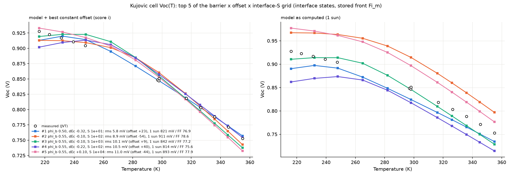

# Voc(T) calibration of the rebuilt Kujovic cell: back barrier × front offset × interface S

**Model.** This is the Sesame model from `../README.md`, which matches SCAPS to within 0.4 mV, with two changes:
- **Front recombination:** it sits on interface states that couple the **ZnO conduction band** to the **absorber
  valence band** (`sesame_cell.add_interface_defect`), the right channel for a cliff. The IL keeps only the bulk
  τ (10 ns).
- **Everything else as K_c_graded_flat:** graded Eg 1.50→1.41 eV, NA 3e16→1e16, ZnO ND 1e11, front contact at the
  stored Fi_m 4.10 eV, Rs 0, AM1.5G. The back metal is fixed at VBM(300 K) − φ_b. Temperature handling: dEg/dT
  −4e-4 eV/K, f_cb 0.5, Nc and Nv ∝ T^1.5.

**Runs.** The defs come from `kujovic_vocT.build_T` (in `./defs`). Every curve has 11 temperatures at 1 sun and
0.5 sun, plus a 300 K 1-sun J-V. Each curve is saved atomically to `curves/` the moment it finishes, and
`calibrate.py` skips curves whose CSV exists.

| Set | φ_b (eV) | dEc (eV) | S (cm/s) | Curves |
|---|---|---|---|---|
| Requested | 0.45, 0.50, 0.55 | +0.10, −0.10, −0.22, −0.32 | 1e3, 1e4, 1e5 | 36 |
| Extension (not requested) | 0.45, 0.50, 0.55 | −0.10, −0.22, −0.32 | 1e1, 1e2 | 18 |

I added the extension because every requested measured-cliff curve came out 100–380 mV too low.

All 54 × 11 points converged (`n_ok` = 11), with the default light ramp (`ramp_variant` 0).

**Scoring** (`calib_scores.csv`), against the 13 measured JVT points with the model interpolated linearly in T:
- **(i) shape:** RMS after removing a free constant Voc offset.
- **(ii) intensity:** RMS with a free light-intensity factor X and no offset, using
  Voc(X) = Voc(1) + m(T)·ln X. Here m(T) = (Voc(1) − Voc(0.5))/ln 2 is computed at every T, and X ∈ [0.02, 5].
  Direct reruns at the fitted X for the top 3 agree with the linearisation to within 2.3 mV in RMS
  (`calib_intensity_check.csv`).
- **Also reported:** the 316–355 K slope and 0 K intercept, the 216–248 K slope, and the 300 K 1-sun J-V.
- **Ranking:** first by the 1-sun test (Voc within 20 mV of 875.5 and FF ≥ 78%), then by a plausible JVT offset
  (|offset| ≤ 60 mV; the JVT/J-V gap itself is 25 mV), then by shape RMS.

## Result: no curve passes the 1-sun test

None of the 54 curves has 1-sun Voc within 20 mV of 875.5 mV **and** FF ≥ 78%. The near misses are:

| Curve | 1-sun Voc (mV) | FF (%) | Shape RMS (mV) | Intercept (eV) |
|---|---|---|---|---|
| φ_b 0.55, +0.10, S 1e4 | 893 | 77.9 | 11.0 | 1.55 |
| φ_b 0.50, +0.10, S 1e4 | 896 | 81.1 | 30.4 | 1.56 |

**Top 5** (measured: −1.70 mV/K, 1.357 eV, −0.74 mV/K at low T, 850 mV at 298 K; 1-sun J-V 875.5 mV / 80.48% / 21.44%):

| # | φ_b | dEc | S | RMS (i), offset (mV) | RMS (ii), X | slope 316–355 (mV/K) | intercept (eV) | slope 216–248 | Voc 298 K | 1 sun: Voc / FF / eta |
|---|---|---|---|---|---|---|---|---|---|---|
| 1 | 0.50 | −0.32 | 1e1* | 5.8, +23 | 10.4, 1.63 | −1.60 | 1.301 | +0.04 | 824 | 821 / 76.9 / 17.60 |
| 2 | 0.55 | −0.10 | 1e2* | 8.9, −54 | 27.4, 0.18 | −2.14 | 1.559 | −0.12 | 914 | 911 / 78.6 / 19.97 |
| 3 | 0.55 | −0.10 | 1e3 | 10.1, +9 | 9.0, 1.39 | −2.07 | 1.465 | +0.11 | 846 | 842 / 77.2 / 18.14 |
| 4 | 0.55 | −0.22 | 1e2* | 10.5, +40 | 23.3, 2.66 | −1.83 | 1.364 | +0.36 | 817 | 814 / 75.6 / 17.15 |
| 5 | 0.55 | +0.10 | 1e4 | 11.0, −44 | 31.3, 0.32 | −2.17 | 1.547 | −0.49 | 897 | 893 / 77.9 / 19.42 |

\* from the extension (S below the requested range). Also close: φ_b 0.50, −0.22, S 1e2* has RMS 13.9 (8.3 in
(ii)), intercept 1.366 eV, slope −1.83, 1 sun 815 / 79.2.

## What each parameter controls

- **φ_b sets the low-T flattening.**
  - 0.55 eV gives 216–248 K slopes of about 0 (−0.5 to +0.4 mV/K for S ≤ 1e4; −1.3 for +0.10 eV at S 1e5),
    against a measured −0.74.
  - 0.45 eV is too weak: −1.0 to −3.1 mV/K, and every 0.45 eV curve has shape RMS ≥ 11 mV.
  - The earlier 0.655 eV run over-flattens (rollover).
- **The interface gap (Eg − |dEc|) together with S sets the high-T intercept and slope.**

  | Front | Intercept (eV) | Slope (mV/K) | Voc at 298 K (mV) |
  |---|---|---|---|
  | Spike +0.10, S ≥ 1e3 | 1.47–1.63 (bulk-like) | −2.1 to −2.3 | — |
  | Measured cliffs (−0.22/−0.32) with requested S (1e3–1e5) | 1.20–1.33 | −2.0 to −2.5 | 470–730 |

  - The spike cannot produce the 1.36 eV intercept.
  - The measured cliffs at the requested S are excluded: they need +100 to +380 mV offsets.
- **Only the measured cliffs with a low S reach the measured intercept and slope.** They bracket it:

  | Front | Intercept (eV) | Slope (mV/K) |
  |---|---|---|
  | −0.22 eV, S 1e2 | 1.364–1.366 | −1.83 |
  | −0.32 eV, S 1e1 | 1.301 | −1.60 |
  | Measured | 1.357 | −1.70 |

  So an effective cliff near −0.25 to −0.3 eV with S of about 1e1–1e2 cm/s would sit on the measured line.
- **Below about 1e1–1e2 cm/s the bulk takes over.** −0.22 eV at S 1e1 is bulk-limited: intercept 1.52 eV.

**dEg/dT sensitivity** (`calib_dEgdT_sensitivity.csv`, for the top 3 plus candidate #4): from −3e-4 to −4.5e-4 eV/K
the intercept moves by +0.04 eV in every case.

| Candidate | −3e-4 | −4e-4 | −4.5e-4 |
|---|---|---|---|
| #1 | 1.273 | 1.301 | 1.315 |
| #4 | 1.335 | 1.364 | 1.378 |

Voc at 298 K changes by < 0.5 mV, and the shape RMS by 0.5–2.7 mV. With −3e-4 the −0.22 eV/S 1e2 cell sits at
1.335 eV, and with −4.5e-4 at 1.378 eV. The assumption therefore matters at the ±0.03 eV level, which is the size
of the gap between the −0.22 and −0.32 cliffs.

**Dead window** (`calib_dead_window.csv`, candidate #1, FTO and ZnO τ = 1e-12 s):

| Wavelength | Model EQE, live window | Model EQE, dead window | Measured EQE |
|---|---|---|---|
| 320 nm | ~90% | 8.5% | 46% |
| 350 nm | ~90% | 39% | — |
| 370 nm | ~90% | 42% | 31–46% (340–370 nm) |
| 400 nm | ~90% | 85% | — |

So a dead window brings 340–400 nm onto the measurement. At 320 nm it overshoots downward (8.5% against 46%):
the rising measured EQE there is not reproduced. Jsc falls by 1.0 mA/cm² (27.86 → 26.85), and Voc and FF change by
≤ 2 mV and ≤ 0.1 points.

## Reading: what the data require

1. **A back barrier of about 0.5–0.55 eV** for the low-T flattening. This is robust across all fronts.
2. **A front recombination channel with activation about 1.30–1.37 eV and a 316–355 K slope of about −1.6 to
   −1.8 mV/K.** In this model only the measured XPS cliffs (−0.22 to −0.32 eV) give it, recombining through
   interface states at a low S (1e1–1e2 cm/s). The authors' assumed +0.10 eV spike cannot reproduce the intercept
   at any S tested (1.47–1.63 eV).
3. **What does not fit: absolute room-temperature Voc and FF.**
   - At 1 sun, the cliff candidates that fit the intercept give 814–821 mV, which is 54–62 mV below the champion
     J-V and 26–33 mV below the JVT point at 298 K. Their FF is 75.6–79.2%.
   - In (ii) they need X ≈ 1.6–2.7 suns, the wrong direction if the JVT setup gave less light than the 1-sun J-V.
   - Within this grid the gap cannot be closed. Lowering S raises Voc, but below about 1e1–1e2 cm/s the 10 ns bulk
     takes over and the intercept returns to 1.52 eV.
   - The untested way out: a longer bulk lifetime (≳ 30–100 ns) would let S drop further while the cliff interface
     stays dominant. That would raise Voc at fixed intercept, and possibly FF.
4. **Bottom line:** the Voc(T) data favour the measured cliff (about −0.22 to −0.32 eV) over the authors' assumed
   spike, combined with a back barrier of about 0.5–0.55 eV. The remaining 30–60 mV room-temperature Voc deficit
   points at the bulk lifetime (or another non-front loss), not at the front.

## Caveats

- **Assumed temperature model:** the reconstruction's gap shift, half and half band-edge split, ZnO affinity tied
  to the absorber conduction band, and constant mobilities, vth and σ. Only dEg/dT was varied.
- **Shape-score weighting:** the 13 measured points (5 low-T, 3 at about 298 K, 5 high-T) are equally weighted.
  The free offset in (i) removes the absolute level, so (i) mostly scores the curvature and the slopes.
- **What the J-V criteria use:** the 1-sun test uses the model J-V at 300 K with Rs = 0. The measured champion FF
  includes its own Rs and shunt.
- **Interface states:** single level at mid interface gap, equal capture cross-sections. Neutral, so they add no
  interface charge.
- **Search scope:** S values below 1e3 and the dead-window run are outside the requested grid. They are labelled
  in the CSVs (`in_requested_grid`).

## Files

| File | What it is |
|---|---|
| `calibrate.py` | stages: `grid`, `ext`, `score`, `sens`, `xcheck`, `dead` |
| `curves/<tag>_vocT.csv` | per curve: Voc at 1 and 0.5 sun, m, Jsc, FF at each T |
| `curves/<tag>_jv300.csv` | 300 K 1-sun J-V |
| `calib_scores.csv` | all 54 curves ranked |
| `calib_vocT_top.png` | top 5 |
| `calib_dEgdT_sensitivity.csv` | intercept against dEg/dT |
| `calib_intensity_check.csv` | linearised against direct intensity fits |
| `calib_dead_window.csv`, `calib_dead_window_eqe.csv` | dead-window J-V and EQE |
