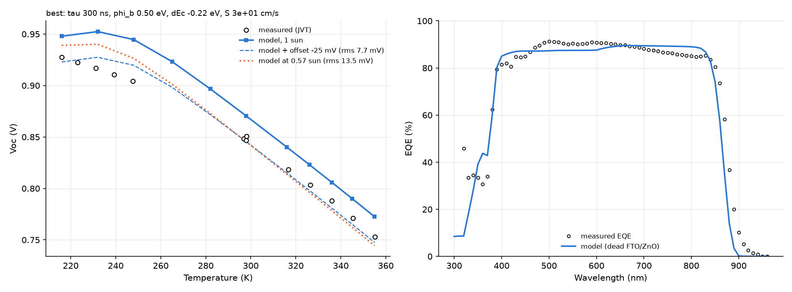

# Does a longer bulk lifetime let the measured-cliff fits pass? (calib2)

**Model.** This is the model from `../calib`, with three settings:
- **Front:** interface states couple the ZnO conduction band to the absorber valence band. The front contact uses
  the stored Fi_m of 4.10 eV.
- **Back:** the metal is fixed at VBM(300 K) − φ_b. Temperature: dEg/dT −4e-4 eV/K, f_cb 0.5.
- **New here:** dead FTO/ZnO (τ = 1e-12 s) and a variable bulk τ, applied to every absorber sublayer and the IL.
  That is equivalent to changing Nt at fixed σ.

**Runs and scoring:**
- **Per curve:** 11 temperatures at 1 and 0.5 sun, plus a 300 K 1-sun J-V.
- **Scoring, as in `../calib`:** shape RMS with a free offset (i), and free light intensity (ii), over the 13 JVT
  points.
- **Pass test:** 1-sun Voc within 20 mV of 875.5 and FF ≥ 78%.
- **Ranking:** passing curves first, then plausible offsets (|offset| ≤ 60 mV), then shape.
- **Storage:** every curve is written atomically to `curves/` and skipped when it exists.
- **Convergence:** all 47 × 11 points converged on the default light ramp.

| Set | τ (ns) | φ_b (eV) | dEc (eV) | S (cm/s) | Curves |
|---|---|---|---|---|---|
| Main (requested) | 30, 100, 300 | 0.50, 0.55 | −0.22, −0.32 | 1e1, 1e2, 1e3 | 36 |
| Control (requested) | 30, 100 | 0.55 | +0.10 | 1e3, 1e4 | 4 |
| Extension (mine) | see below | | | | 7 |

The extension sets S between the requested grid values, where the 1-sun Voc of the cliff cells crosses 875 mV:
- −0.22 eV, S 3e1, with τ 100/300 ns and φ_b 0.50/0.55;
- −0.32 eV, S 3e0, with τ 300 ns and φ_b 0.50/0.55;
- −0.22 eV, S 3e1, τ 10 ns, φ_b 0.50 (to test whether the longer τ is needed).

## Answer: lifetime alone does not do it; S does

- **None of the 40 requested curves passes.**
- **The lifetime barely matters.** From τ 30 to 300 ns, the 1-sun Voc changes by ≤ 3 mV at fixed (φ_b, dEc, S). For
  example: −0.22 eV / S 1e2 gives 813–814 mV, −0.32 eV / S 1e1 gives 820–821 mV, and −0.22 eV / S 1e1 gives
  913–916 mV. With the interface states seeing the ZnO electrons, the cliff interface sets Voc once S ≳ 1e1.
- **What does change the room-temperature level is S:** about 100 mV per decade. On the measured −0.22 eV cliff,
  S 1e1 overshoots (913–916 mV, but the intercept slides to 1.45–1.49 eV), and S 1e2 undershoots (813–814 mV).
- **S 3e1 between them passes,** and it keeps the right Voc(T) shape. It passes with τ 100 and 300 ns, and also with
  τ 10 ns (865 mV, FF 79.1%).
- **What the longer τ does:** it only improves the shape slightly (RMS 7.7 against 10.0 mV, intercept 1.389 against
  1.417 eV, slope −1.74 against −1.84 mV/K). It is not what makes the cell pass.
- **The authors' +0.10 eV spike controls:** they come closest among the requested curves (898–901 mV, FF 78.5–78.8,
  outside the Voc window by 2–6 mV). But their intercept is 1.51–1.52 eV and slope −2.0 to −2.1 mV/K, so they do not
  produce the 1.36 eV intercept.

**Top 5** (measured: −1.70 mV/K, 1.357 eV, −0.74 mV/K at low T, 850 mV at 298 K; 1-sun J-V 875.5 mV / 80.48% / 21.44%):

| # | Set | τ (ns) | φ_b | dEc | S (cm/s) | RMS (i), offset | RMS (ii), X | slope 316–355 | intercept | slope 216–248 | 1 sun Voc / Jsc / FF / eta | Pass |
|---|---|---|---|---|---|---|---|---|---|---|---|---|
| 1 | ext | 300 | 0.50 | −0.22 | 3e1 | 7.7, −25 | 13.5, 0.57 | −1.74 | 1.389 | −0.10 | 867 / 27.08 / 79.5 / 18.67 | yes |
| 2 | ext | 100 | 0.50 | −0.22 | 3e1 | 7.8, −25 | 13.6, 0.57 | −1.74 | 1.391 | −0.11 | 867 / 27.06 / 79.5 / 18.65 | yes |
| 3 | ext | 10 | 0.50 | −0.22 | 3e1 | 10.0, −23 | 15.1, 0.60 | −1.84 | 1.417 | −0.17 | 865 / 26.88 / 79.1 / 18.37 | yes |
| 4 | control | 100 | 0.55 | +0.10 | 1e4 | 5.7, −50 | 30.0, 0.24 | −2.02 | 1.512 | −0.44 | 901 / 27.07 / 78.8 / 19.21 | no (Voc +25.5) |
| 5 | main | 30 | 0.50 | −0.32 | 1e1 | 6.2, +24 | 11.7, 1.65 | −1.57 | 1.291 | +0.07 | 820 / 27.00 / 77.3 / 17.11 | no (Voc −55) |

Also of note:
- −0.32 eV / S 3e0 / φ_b 0.50 / τ 300 (ext) gives 881 mV with FF 77.6, so it misses the FF test by 0.4. It has the
  best free-intensity fit in this folder: 5.3 mV at X = 0.46. A deeper cliff with lower S is nearly interchangeable
  with −0.22 eV / S 3e1.
- φ_b 0.55 at −0.22 eV / S 3e1 fails on FF (76.1%).

## The best case: τ 300 ns, φ_b 0.50 eV, dEc −0.22 eV, S 3e1 cm/s

**Loss breakdown at 300 K, 1 sun** (`best_loss_breakdown.csv`, mA/cm²). The generated current is 28.22. Every row
closes to < 1e-4.

| Point | V | J | Front interface | Bulk SRH | Back contact (electrons) | Dead FTO/ZnO | Front contact (holes) |
|---|---|---|---|---|---|---|---|
| short circuit | 0 | 27.08 | 0.000 | 0.008 | 0.126 | 1.009 | 0.000 |
| maximum power | 0.728 V | 25.65 | 1.327 | 0.017 | 0.181 | 1.046 | 0.000 |
| open circuit | 0.867 V | 0 | 26.68 (94.5%) | 0.058 (0.2%) | 0.424 (1.5%) | 1.057 (3.7%) | 0.000 |

- **At open circuit the cliff interface is essentially the only recombination path.** That is why bulk τ no longer
  matters.
- **At the MPP** the interface takes 1.33 mA/cm², the largest voltage-dependent loss. The dead window is a fixed
  1.0 mA/cm² optical loss. The back contact leaks 0.13–0.42 mA/cm² of electrons.

**EQE** (`best_eqe.csv`, figure right):

| Quantity | Value |
|---|---|
| Integrated over 320–960 nm (SCAPS AM1.5G) | 27.06 mA/cm² |
| J-V Jsc | 27.08 mA/cm² |
| Measured EQE integral | 27.69 mA/cm² (−2.3%) |
| RMS against the measured EQE | 7.9 points (was 18 with a live window) |

- With the dead window, 340–400 nm matches (39–43% at 350–370 nm against a measured 31–34%).
- Still off: 320 nm (8.6% against 46%), and the band edge is about 12 nm blue (35% against 58% at 870 nm).

**Voc(T)** (`best_vocT_eqe.png`, left):
- **1-sun curve:** 25 mV above the JVT points at every temperature.
- **With a constant offset:** RMS 7.7 mV.
- **With free intensity:** RMS 13.5 mV at X = 0.57 sun. This fits the JVT/J-V gap (850 against 875.5 mV), which
  implies the JVT rig gave less light.
- **High T:** the slope (−1.74 mV/K) and intercept (1.389 eV) are close to the measured −1.70 and 1.357.
- **Low T:** the flattening is over-done: −0.10 against −0.74 mV/K.

**One-parameter steps around the best case** (300 K, 1 sun; `best_sensitivity_1sun.csv`):

| Step | ΔVoc (mV) | ΔFF | Still passes? |
|---|---|---|---|
| τ ×3 / ÷3 | +0.1 / −0.2 | ±0.04 | yes |
| φ_b +0.05 / −0.05 eV | −1.7 / +0.3 | −3.4 / +1.3 | no (FF 76.2) / yes |
| S ×3 / ÷3 | −48.6 / +49.3 | +0.1 / +0.0 | no / no |
| dEc 0.05 eV shallower / deeper | +46.8 / −49.5 | +1.1 / −0.9 | no / no |

- **Voc is set by S and dEc together,** at about 100 mV per decade of S or about 1 mV per meV of cliff. They trade
  off: 0.1 eV deeper is roughly a 10× lower S.
- **FF is set by φ_b.**
- **The bulk τ does neither.**
- **The pass window is narrow:** S within about ×1.5 of 3e1 at −0.22 eV, or dEc within about ±0.02 eV at S 3e1.

## Physics reading

1. **Cliff:** the data are consistent with the measured XPS cliff (−0.22 eV, the MOCVD value). An effective
   −0.22 to −0.32 eV cliff with a matching low S fits as well.
2. **Recombination path:** at room temperature and above, recombination goes through interface states at the
   ZnO/CdSeTe cliff. This one channel gives the 1.36–1.39 eV intercept, the −1.7 mV/K slope, and the 865–867 mV
   1-sun Voc with FF 79–80%. That needs an interface recombination velocity of only about 3e1 cm/s (or about 3 cm/s
   for a −0.32 eV cliff), i.e. a very well passivated interface.
3. **Back barrier:** about 0.50 eV produces the low-T flattening and costs little FF at 300 K. 0.55 eV pushes FF
   below 78%.
4. **Bulk lifetime:** τ ≥ 10 ns is enough; between 10 and 300 ns it changes Voc by < 3 mV once the cliff interface
   dominates. The earlier calib result (bulk taking over below S ≈ 1e1–1e2) mattered only at S 1e1.
5. **The authors' +0.10 eV spike** reaches the 1-sun numbers only with S ≈ 1e4 and bulk-like activation (1.51 eV).
   It cannot reproduce the 1.36 eV intercept.

## Caveats

- **S is fine-tuned, and S and dEc are degenerate at 300 K.** The Voc(T) intercept only partly separates them:
  1.389 eV for −0.22 / 3e1 against 1.341 eV for −0.32 / 3e0. A dEg/dT uncertainty of ±0.04 eV (`../calib`) is the
  same size.
- **Remaining misfits:** the low-T slope (−0.10 against −0.74 mV/K), 320 nm EQE, the band-edge position, and Jsc
  (27.1 against the 27.7 EQE integral and the 30.4 J-V). FF and Voc are compared at Rs = 0.
- **Temperature model, inherited assumptions:** gap shift split half and half, ZnO affinity tied to the absorber
  conduction band, and mobilities, vth and σ constant.
- **The pass comes from my extension:** S = 3e1 and 3e0 are outside the requested grid.

## Files

| File | What it is |
|---|---|
| `calibrate2.py` | stages: `grid`, `ext`, `score`, `best`, `sens` |
| `curves/` | per-curve Voc(T) and 300 K J-V CSVs, plus the `sens_*` J-Vs |
| `calib2_scores.csv` | all 47 curves ranked |
| `best_loss_breakdown.csv`, `best_eqe.csv`, `best_summary.csv` | best-case loss breakdown, EQE and summary |
| `best_sensitivity_1sun.csv` | one-parameter steps |
| `best_vocT_eqe.png` | Voc(T) and EQE of the best case |
