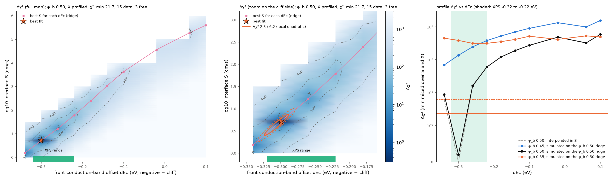

# Identifiability of the front offset dEc and interface S (rebuilt Kujovic cell)

**Model** (the calib2 model):
- **Front recombination:** interface states coupling the ZnO conduction band to the absorber valence band.
- **Window and contacts:** dead FTO/ZnO (τ 1e-12 s), front contact at the stored Fi_m 4.10 eV.
- **Bulk and temperature:** bulk τ 100 ns, dEg/dT −4e-4 eV/K, f_cb 0.5.
- **Back contact:** metal fixed at VBM(300 K) − φ_b, with φ_b = 0.50 eV for the map.

**Runs:**
- **Map:** dEc ∈ {−0.34, −0.30, −0.26, −0.22, −0.18, −0.14, −0.10, −0.02, +0.06, +0.10} eV × log10 S ∈ {0, 0.5, …, 4.0}.
- **What is simulated per point:**
  - a 300 K 1-sun J-V first;
  - when its Voc ≥ 700 mV, Voc at 216, 248, 282, 298, 316, 336 and 355 K, at 1 sun and at 0.5 sun.
- **Added runs:**
  - log S 4.5–6.0 for −0.02, +0.06 and +0.10 eV, because their best S sat at the grid edge. Without this, the spike
    minimum would not be bracketed and its χ² would be biased high.
  - Every best-S point on the ridge simulated directly, at φ_b 0.50, 0.45 and 0.55.
- **Convergence and storage:** 130 records, all converged. Each was written atomically
  to `curves/` and is skipped on rerun.

**χ²** (as specified):
- **Data and σ:** 13 JVT Voc(T) points with σ 4 mV, using a free light factor X ∈ [0.05, 5] suns (Voc_X = Voc_1sun +
  m(T) ln X, with m from the 1/0.5-sun pair; the best X is analytic). The 1-sun J-V Voc 875.5 mV has σ 8 mV, and FF
  80.48% has σ 1.5 points.
- **Degrees of freedom:** 15 data, 3 free parameters (dEc, S, X), so dof = 12.
- **Interpolation:** the model is interpolated in T with PCHIP over the 7 temperatures. Between simulated S values,
  each dEc's model outputs are interpolated in log S with PCHIP. At the ridge points the interpolated χ² agrees with
  direct simulation to within 3.

## Results

**Best fit:** dEc −0.30 eV, S = 10^0.72 ≈ 5 cm/s, X = 0.55 sun, χ²_min = 21.7 (21.9 simulated directly).

| Term | χ² |
|---|---|
| Voc(T) | 18.6 |
| 1-sun Voc (872.5 mV) | 0.1 |
| 1-sun FF (77.8%) | 3.2 |

χ²/dof = 1.8 (p ≈ 0.04), a modestly poor fit with these σ.

**Confidence region** (Δχ² 2.3 / 6.2, 2 parameters). The dEc grid step (0.04 eV) is wider than the region, so its
edges come from a parabola through the simulated profile at −0.34, −0.30 and −0.26 eV.

| Quantity | 68% | 95% |
|---|---|---|
| dEc (eV) | −0.324 to −0.288 | −0.335 to −0.277 |
| S at fixed dEc −0.30 (log10) | 0.65–0.78 | 0.61–0.82 |
| S along the valley (log10) | — | ≈ 0.26–1.00 (S ≈ 2–10 cm/s) |

- **The region is a thin valley along the degeneracy ridge.** The best S rises 12.9 decades per eV of cliff
  depth, about 1.3 decades per 0.1 eV. A local quadratic gives curvatures A = 546 per decade² across the valley and
  P = 7.6e3 per eV² along it.
- **XPS range (−0.32 to −0.22 eV):** only its deep end is inside. The CSS value (−0.32 eV) lies inside the 68%
  region. The MOCVD value (−0.22 eV) sits at Δχ² = 60, formally excluded.

**Profile Δχ² against dEc** (minimised over S and X, simulated on the ridge; `ident_profile.csv`):

| dEc (eV) | −0.34 | −0.30 | −0.26 | −0.22 | −0.18 | −0.14 | −0.10 | −0.02 | +0.06 | +0.10 |
|---|---|---|---|---|---|---|---|---|---|---|
| best log10 S | 0.19 | 0.72 | 1.22 | 1.79 | 2.39 | 3.03 | 3.63 | 4.56 | 5.28 | 5.60 |
| Δχ², φ_b 0.50 | 8.7 | 0.2 | 16.1 | 59.9 | 120.6 | 189.2 | 272.9 | 482.1 | 322.4 | 588.9 |
| 1-sun Voc on the ridge (mV) | 894 | 873 | 855 | 835 | 817 | 801 | 791 | 792 | 791 | 778 |

**Spike against cliff.**
- **Best spike:** +0.06 eV with S ≈ 1.9e5 cm/s has Δχ² = 322 against the best cliff. Of its χ², 234 comes from
  Voc(T) and 111 from the 1-sun Voc.
- **Why it fails on both:** with a spike, recombination only reaches the measured Voc(T) slope at very high S, and
  that pulls the 1-sun Voc down to about 790 mV. At the S that restores 875 mV, the activation is bulk-like
  (1.5 eV) and the Voc(T) shape fails.
- **φ_b does not rescue it:** with φ_b at 0.45 or 0.55 the best spike is no better (φ_b 0.55 at +0.10 eV gives
  Δχ² 489).
- **The authors' +0.10 eV spike** is at Δχ² ≈ 590 (φ_b 0.50).

**Back barrier:** on the cliff ridge, φ_b 0.45 eV costs Δχ² 69–136 (at −0.34/−0.30 eV) and 0.55 eV costs 313–449. This is driven by
the low-T Voc(T) shape, so φ_b ≈ 0.50 eV is well constrained. S was not re-optimised for those φ_b, but the 1-sun
Voc changes by < 2 mV with φ_b, so the ridge S applies.

*Left: full Δχ² map (φ_b 0.50, X profiled; dotted lines are Δχ² 25/100/400). Middle: zoom on the cliff side with
the local-quadratic 68/95% region (solid/dashed orange) around the best fit. Right: profile Δχ² against dEc for
φ_b 0.45/0.50/0.55 (shaded: XPS range).*

## Honest reading

- **Exclusion of the spike is robust.**
  - It survives inflating σ until χ²/dof = 1 (σ × 1.35): Δχ² becomes ≈ 176.
  - It survives the dEg/dT systematic, which moved the Voc(T) intercept by only ±0.04 eV in `../calib`, against a
    0.36 eV gap between the spike and the best cliff.
  - Within this model the data cannot be fit with the authors' +0.10 eV spike at any S (1e0–4e5 cm/s) or φ_b
    (0.45–0.55 eV).
- **Cliff depth: the data prefer about −0.30 eV, but the precision is formal.**
  - The statistical 95% interval is ±0.03 eV.
  - The temperature-model systematics are of the same size or larger, and are not in the χ²: dEg/dT, the half and
    half band-edge split, and the ZnO affinity following the absorber conduction band. A ±0.04 eV shift of the
    intercept moves the best dEc by about the same amount.
  - So the −0.22 eV exclusion (Δχ² 60, or 33 with inflated σ) is conditional on the temperature model.
  - The defensible statement is that the data favour the deep end of the measured XPS cliff range (CSS −0.32 eV is
    inside 68%) and reject the spike.
- **S and dEc are separated only through the temperature dependence.**
  - At 300 K they are fully degenerate: 0.1 eV deeper is about a 20× lower S (1.3 decades).
  - The separation comes from requiring the same (dEc, S) to give both the JVT shape (slope and intercept, with the
    light level free) and the 875 mV 1-sun Voc. Shallower cliffs need a higher S to produce the measured slope, and
    that lowers the 1-sun Voc (835 mV at −0.22 eV, 791 mV at −0.10 eV on the ridge).
  - Along the valley S is pinned only to log10 S ≈ 0.26–1.00 (95%). Across it, at fixed dEc, it is pinned to
    about ±0.1 decades.
  - **The resulting S of about 2–10 cm/s is an effective interface velocity of this single-level model**, tied to
    the chosen interface-state energy and capture symmetry. It is not a measured property.
- **The fit is not perfect.**
  - χ²/dof = 1.8.
  - The 7-temperature interpolation alone has errors up to 5.3 mV (2.1 mV rms) against the 11-temperature curve,
    comparable to σ.
  - The best fit's FF is 77.8% against 80.48%, the largest single J-V residual.
  - The fitted JVT light level is X = 0.55 sun, consistent with the JVT rig delivering less light than the 1-sun
    J-V (850 against 875.5 mV).
- **This contradicts the earlier "best case".** The calib2 pass (−0.22 eV, S 3e1) is a 1-sun pass with a shape fit
  that used a free offset. Under this joint χ² with free intensity it has χ² ≈ 115, Δχ² ≈ 93. The deeper cliff
  fits the Voc(T) slope better without giving up the 1-sun Voc.

## Files

| File | What it is |
|---|---|
| `ident.py` | stages: `grid`, `extend`, `ridge`, `analyze` |
| `curves/` | one CSV per (φ_b, dEc, log S): 300 K J-V numbers and Voc(T) at 1/0.5 sun |
| `ridge_points.csv` | best log S per dEc used for the ridge runs |
| `ident_map.csv` | χ² per simulated map point |
| `ident_fine_scan.csv` | χ² on a fine log-S scan per dEc |
| `ident_profile.csv` | profile, interpolated and simulated, with φ_b 0.45/0.50/0.55 terms |
| `ident_summary.csv` | χ²_min, intervals, spike-vs-cliff Δχ², interpolation check, quadratic-valley parameters |
| `ident_map.png` | the figure |
