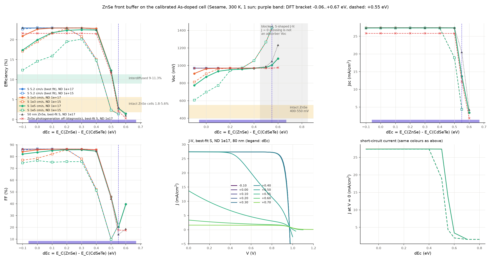

# ZnSe front buffer on the calibrated As-doped cell (Sesame, 300 K, 1 sun)

## Setup

**Base model:** the `../ident` best fit.
- **Front:** interface states couple the buffer conduction band to the absorber valence band. The front contact is
  at the stored Fi_m of 4.10 eV, and the FTO is dead (τ 1e-12 s).
- **Back:** φ_b 0.50 eV, i.e. a metal at 5.31 eV.
- **Absorber:** bulk τ 100 ns, graded absorber as in the Kujovic reconstruction.

**ZnSe replaces the ZnO.**

| Property | Value |
|---|---|
| Eg | 2.70 eV |
| ε | 9.1 |
| Nc / Nv | 1.6e18 / 1.5e19 cm⁻³ (as specified, not the old buffer's 2.2e18 / 1.8e19) |
| μn / μp | 100 / 20 cm²/Vs |
| Thickness | 80 nm (50 nm on the best-fit-S row) |
| χ | χ(CdSeTe front) − dEc = 4.40 − dEc eV |
| Absorption | SCAPS sqrt model α = A·√(hν − 2.70), A = 1.8e5 cm⁻¹ eV^-1/2 (B = 0); 1.1e5 cm⁻¹ at 400 nm, 4.2e4 at 450 nm, 0 beyond 459 nm |
| Recombination | none (τ = 1 s): the layer is live, so carriers made in it are collected if transport allows |

- **Blue loss:** 80 nm of ZnSe absorbs 1.57 mA/cm² of the AM1.5G photon current.
- **Inputs:** every case is built from a SCAPS `.def` written in `defs/` and read back by `kj_sesame.parse_def`,
  which now also reads SCAPS's sqrt absorption model. Sesame and a SCAPS cross-check therefore share one input.

## Runs

| Set | dEc (eV) | S (cm/s) | ND_ZnSe (cm⁻³) | Thickness | Curves |
|---|---|---|---|---|---|
| Main grid (requested) | 11 values, −0.10 to +0.80 | 5.2 (best fit), 1e3, 1e5 | 1e15, 1e17 | 80 nm | 66 |
| Thin row (requested) | same 11 | 5.2 | 1e15, 1e17 | 50 nm | 22 |
| Diagnostic (mine) | same 11 | 5.2 | 1e15, 1e17 | 80 nm, ZnSe photogeneration switched off | 22 |

- **Saved data:** every J-V is saved atomically to `curves/`.
- **Failed:** 4 cases failed in the generation ramp at dEc +0.80 (ND 1e17 at all three S; 50 nm ND 1e15). They are
  reported as failed. The neighbouring +0.70 cases are already fully blocked: J(0) = 1.2–1.6 mA/cm².

## 1. η, Voc, Jsc and FF against dEc

Table: 80 nm, best-fit S. The full set is in `znse_results.csv`.

| dEc (eV) | ND 1e15: Voc / Jsc / FF / η | ND 1e17: Voc / Jsc / FF / η |
|---|---|---|
| −0.10 | 969 / 27.38 / 85.4 / 22.65 | 970 / 27.39 / 86.3 / 22.92 |
| 0.00 | 971 / 27.38 / 86.4 / 22.96 | 970 / 27.39 / 86.3 / 22.91 |
| +0.20 | 970 / 27.38 / 86.0 / 22.84 | 970 / 27.40 / 86.3 / 22.93 |
| +0.30 | 973 / 27.38 / 78.0 / 20.77 | 970 / 27.40 / 86.3 / 22.93 |
| +0.40 | 1055* / 27.38 / 52.1 / 15.05 | 970 / 27.40 / 85.8 / 22.80 |
| +0.50 | 1267* / 18.95 / 9.8 / 2.35 | 978 / 27.38 / 45.9 / 12.29 |
| +0.55 | 1429* / 4.35 / 21.9 / 1.36 | 1005* / 13.70 / 20.2 / 2.78 |
| +0.60 | no J = 0 below 1.6 V; J(0) 1.97 | 1078* / 3.38 / 39.6 / 1.44 |
| +0.70 | J(0) 1.57 | J(0) 1.61 |

\* Above about 0.97 V the "Voc" is the zero crossing of a blocked, S-shaped J-V, not an absorber Voc.
- The absorber's own limit here is about 970 mV.
- In the blocked regime the remaining current is mostly ZnSe-generated. With ZnSe photogeneration off,
  J(0) at +0.70 eV falls from about 1.6 to 0.02–0.05 mA/cm².
- Even without ZnSe photogeneration, ND 1e15 still crosses zero above 1 V (1.03–1.27 V at +0.50 to +0.60 eV).
  Forward electron injection over the spike is blocked too.

**What the interface S does:**
- **On the cliff/flat side it matters.** At dEc −0.10 eV, Voc is 969 / 909 / 774 mV for S 5.2 / 1e3 / 1e5 with
  ND 1e17, and 969 / 811 / 606 mV with ND 1e15.
- **For a spike of +0.3 eV or more it does not.** The spike repels electrons from the interface states.

**Best efficiency:** 22.9–23.0% for dEc between −0.10 and +0.40 eV (ND 1e17) or −0.10 and +0.20 eV (ND 1e15), at
low S.

## 2. Where electron transport collapses

The criterion is FF or J(0) below 50% of the best in the series (`znse_collapse.csv`).

| ND_ZnSe | Last working dEc | First collapsed dEc | Same at S 5.2 / 1e3 / 1e5 and 50 nm? |
|---|---|---|---|
| 1e15 | +0.40 (FF 52%) | +0.50 (FF 10%, J(0) 18.9) | yes |
| 1e17 | +0.50 (FF 46%) | +0.55 (FF 20%, J(0) 13.7) | yes (50 nm: same) |

- **It does not depend on S.** The collapse dEc is identical for all three S values.
- **It depends on the ZnSe doping by about 0.05 eV.** The 1e17 ZnSe pulls its conduction band down and
  tolerates a larger spike.
- **Thickness, 50 against 80 nm:** this does not move the threshold, though 50 nm keeps more Jsc at the edge
  (+0.50 eV, ND 1e15: J(0) 27.35 against 18.95).
- **Earlier warning sign:** FF starts to fall well before collapse, at about +0.30 eV (ND 1e15) and about +0.45 eV
  (ND 1e17).
- **The relaxed-interface DFT value (+0.55 eV) sits exactly at the collapse edge** for both dopings. The
  pseudomorphic bracket (−0.06 to +0.67 eV) spans the whole range from harmless to fully blocked.

## 3. Against the measured ZnSe devices (`data/znse/znse_devices.csv`)

**Interdiffused / consumed ZnSe (USF 1997–98: 9.0% at 726 mV, 11.3% at 724 mV).**
- The model gives ≥ 9% for every dEc ≤ +0.40 eV (ND 1e15) or ≤ +0.50 eV (ND 1e17), at all S.
- So an effective offset of ≲ +0.4 eV is consistent with these cells. That is what interdiffusion into a graded
  Cd(Zn)(Se)Te front would produce.
- **Their absolute Voc (≈ 725 mV) is far below the model's 960–970 mV.** That is expected: our absorber is the
  calibrated As-doped 21% absorber, not a 1990s CSS CdTe. Compare trends, not absolutes.

**Intact ZnSe (1.8–5.6%, Voc 400–550 mV, Jsc 6–17 mA/cm², FF 30–60%).**
- The model reaches 1.0–6.4% only in a narrow window, dEc ≈ +0.50 eV (ND 1e15) to +0.55 eV (ND 1e17), plus
  +0.60 eV at 1e17 and +0.50–0.55 eV at 50 nm. That is the collapse edge.
- There J(0) is mostly 3–20 mA/cm² (27 for 50 nm at +0.50 eV, where the FF collapses first), overlapping the
  measured 6–17.
- The efficiency and Jsc of intact cells are therefore consistent with a spike of about +0.50–0.60 eV, i.e. the
  relaxed DFT value.
- **The model cannot reproduce Voc 400–550 mV anywhere:**
  - Working cells give 606–972 mV.
  - Blocked cells have no physical Voc (zero crossings above 1 V, or none).
  - The measured low Voc needs physics outside this model: leakage or tunnelling through the spike, shunts, or a
    poorer absorber with high interface S.

## 4. SCAPS cross-check defs (`defs/`)

The three requested defs are written: `ZnSe_dEcp0.30_Sbest_ND1e17_d80.def`, `ZnSe_dEcp0.55_Sbest_ND1e17_d80.def`
and `ZnSe_dEcp0.70_Sbest_ND1e17_d80.def`. `defs/README_scaps_crosscheck.txt` lists their contents.

| Part | What the def contains |
|---|---|
| Back contact | Fi_m 5.31 eV, flatband 0 |
| Front contact | flatband 1 / recalculate 0, Fi_m 4.10 eV |
| Absorber | graded, tau 100 ns: Nt 5e11 cm⁻³, σ 2e-12 cm², midgap |
| IL | bulk block only (the S block is left out, for you to add) |
| ZnSe | as above, sqrt absorption, no defects |
| FTO | dead: neutral midgap block, Nt 1e17 cm⁻³, σ 1e-12 cm² (τ 1e-12 s) |

- **Interface block to add:** S = 5.21 cm/s, single neutral level at mid interface gap, equal capture. That matches
  Sesame's two-node states.
- **Absorption files:** the absorber files are the existing `CdTe_shift_*.abs`.
- **Matching Sesame results** (best-fit S, ND 1e17, 80 nm):

  | dEc | Sesame result |
  |---|---|
  | +0.30 | 970.0 mV / 27.40 / 86.3% / 22.93% |
  | +0.55 | S-shaped, J(0) 13.70, J = 0 at 1.005 V, FF 20.2, η 2.78% |
  | +0.70 | blocked, J(0) 1.61 mA/cm², no J = 0 below 1.6 V |

## Honest reading

- **On the calibrated As-doped absorber, a ZnSe front is harmless** (≈ 22.9%, matching the best ZnO-cliff
  calibrated cell's absorber limit) for offsets up to about +0.4–0.5 eV. Low interface S is needed only when the
  offset is a cliff or flat.
- **Electron extraction collapses at a spike of +0.50 eV (ND 1e15) to +0.55 eV (ND 1e17), independent of S.**
  The preliminary relaxed DFT offset (+0.55 eV) puts an intact ZnSe/CdSeTe junction right on that edge. That
  explains why intact ZnSe cells fail (Jsc and η in the measured range) while interdiffused ones work (effective
  offset ≲ +0.4 eV). It is the hypothesis the undergraduate FTO/ZnSe/CdTe project could not test.
- **The exact threshold is uncertain at the ±0.05–0.1 eV level for three reasons:**
  - Transport over the abrupt spike is drift-diffusion with quasi-Fermi-level continuity. That is effectively
    unlimited thermionic velocity; SCAPS uses vth = 1e7 cm/s, which should block somewhat earlier.
  - Neither code includes tunnelling, which would push the threshold later for thin, heavily doped ZnSe.
  - "Live" ZnSe with no recombination is an idealisation. It adds 1.57 mA/cm² of blue current (1.3 points of η).
    In the blocked regime it supplies most of the residual current and the above-1-V zero crossings.

## Files

| File | What it is |
|---|---|
| `znse.py` | stages: `grid`, `genoff`, `defs`, `analyze` |
| `curves/` | per-case J-V |
| `znse_results.csv`, `znse_results_ZnSeGenOff.csv` | results |
| `znse_collapse.csv` | collapse thresholds and ranges matching the measured devices |
| `znse_maps.png` | figure |
| `defs/` | SCAPS defs for every simulated (dEc, ND, d), plus the three named cross-check defs and their README |
